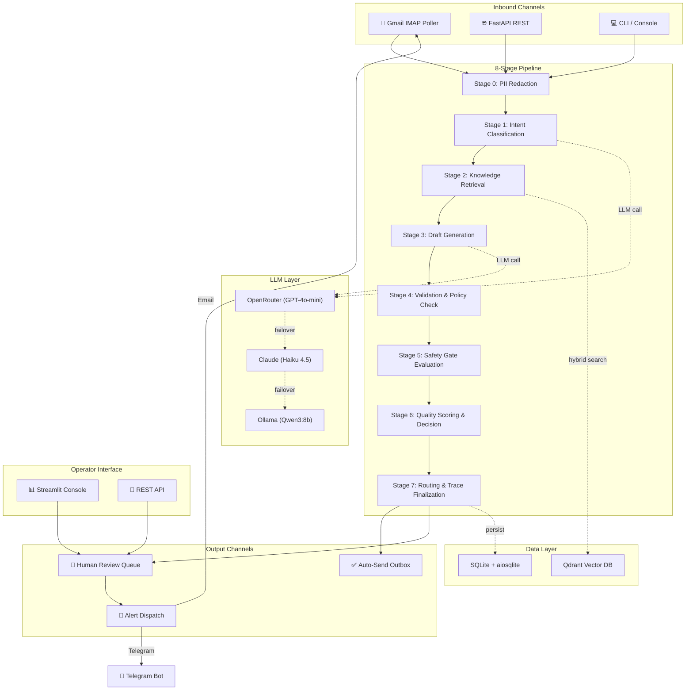
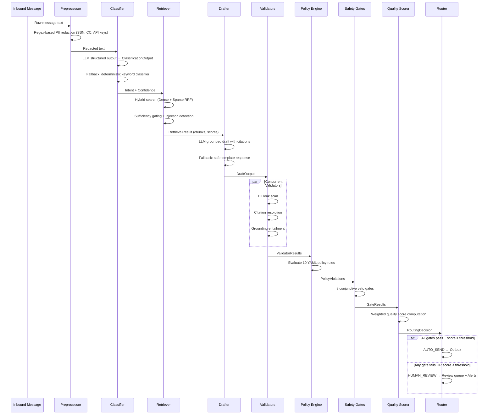
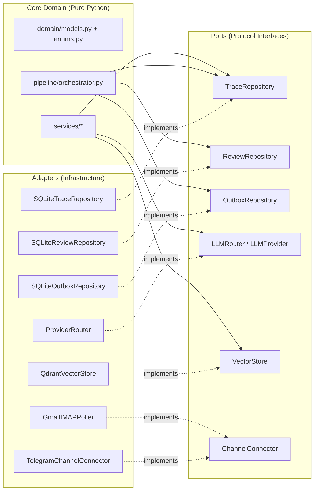
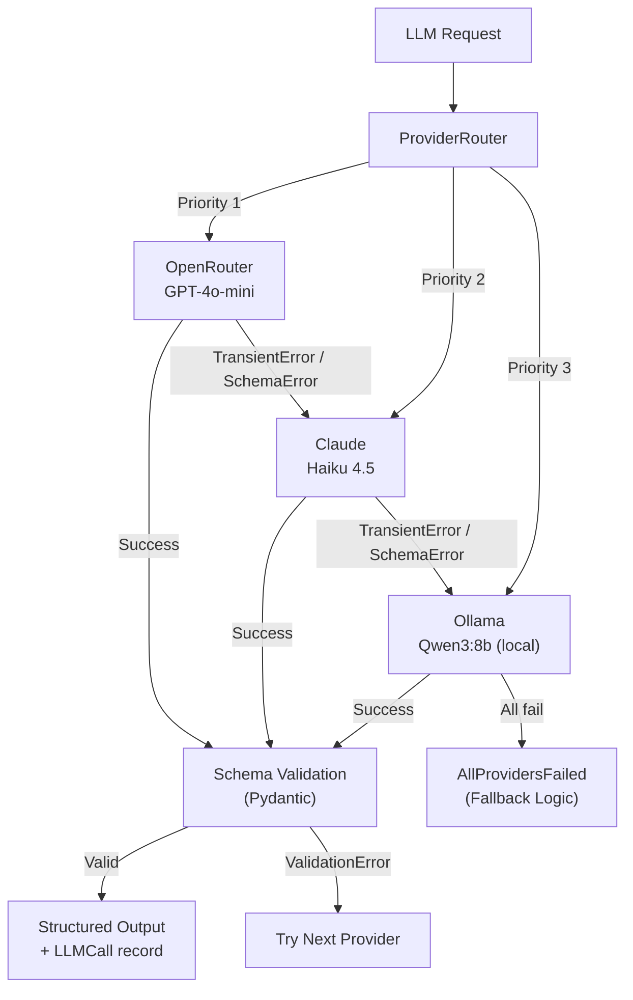
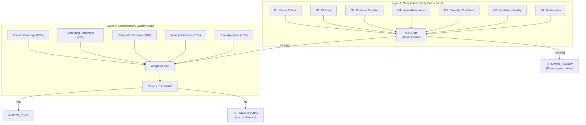
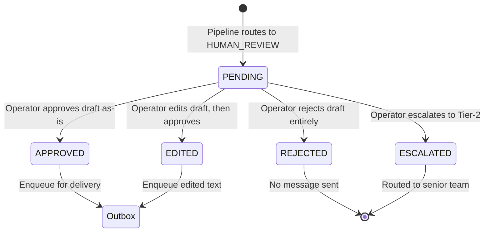

# TaskFlow — Complete Project Architecture & System Design

> **Version:** 1.1 · **Last Updated:** 2026-08-25
>
> Re-verified against the code during the takeover remediation of 2026-08-25. Where this
> document and the code disagreed, the code was corrected or this document was. See
> `docs/REMEDIATION_STATUS.md` for what changed and `docs/BRD.md` for what is required.
> **Repository:** [github.com/Vansh-Rautela/TaskFlow](https://github.com/Vansh-Rautela/TaskFlow)

---

## Table of Contents

1. [Project Context & Problem Statement](#1-project-context--problem-statement)
2. [What TaskFlow Does — In Depth](#2-what-taskflow-does--in-depth)
3. [System Architecture Overview](#3-system-architecture-overview)
4. [The 8-Stage Pipeline — Deep Dive](#4-the-8-stage-pipeline--deep-dive)
5. [Domain Model & Data Contracts](#5-domain-model--data-contracts)
6. [Hexagonal Architecture & Ports/Adapters](#6-hexagonal-architecture--portsadapters)
7. [LLM Provider Router & Multi-Model Strategy](#7-llm-provider-router--multi-model-strategy)
8. [Two-Layer Confidence Architecture (ADR-001)](#8-two-layer-confidence-architecture-adr-001)
9. [Policy Engine & Business Rules](#9-policy-engine--business-rules)
10. [Human-in-the-Loop Review System](#10-human-in-the-loop-review-system)
11. [Multi-Channel Alerting & Delivery](#11-multi-channel-alerting--delivery)
12. [Persistence & Observability](#12-persistence--observability)
13. [API Surface](#13-api-surface)
14. [Technology Stack](#14-technology-stack)
15. [Directory Structure Reference](#15-directory-structure-reference)
16. [Configuration & Tunables](#16-configuration--tunables)
17. [Security & Safety Design Principles](#17-security--safety-design-principles)

---

## 1. Project Context & Problem Statement

### The Challenge

Enterprise customer support teams face a fundamental tension: **speed vs. safety**. Customers expect instant, accurate responses. But sending an AI-generated reply that contains a hallucinated refund policy, leaks a customer's SSN, or promises a feature launch date that doesn't exist can cause legal liability, brand damage, and regulatory violations.

Existing solutions either:
- **Fully automate** responses (fast, but dangerous — no guardrails against hallucinations or policy violations), or
- **Fully rely on human agents** (safe, but slow, expensive, and unscalable).

### The Opportunity

TaskFlow addresses this by building an **AI Support Agent with Enterprise Governance** — a system where:
- High-confidence, policy-compliant responses are **automatically sent** without human delay.
- Low-confidence, sensitive, or policy-violating responses are **routed to human operators** for review, with the AI draft pre-attached so the human only refines rather than writes from scratch.
- Every decision is **fully traceable**, every LLM call is cost-tracked, and every safety gate is auditable.

### Who is this for?

TaskFlow is designed for:
- **SaaS companies** with B2B customer support teams handling billing, technical, account, and refund inquiries.
- **Operations teams** that need to deploy AI assistance without surrendering governance.
- **Compliance-sensitive industries** where every outbound communication must be auditable and policy-compliant.

---

## 2. What TaskFlow Does — In Depth

TaskFlow is a **production-grade AI Customer Support Engine** that processes inbound customer emails through an 8-stage pipeline, generating context-grounded draft responses, validating them against safety gates and business policies, and routing them to either automatic delivery or human review.

### Core Capabilities

#### 2.1 Intelligent Intent Classification
Every inbound message is classified into one of 8 canonical intents using structured LLM output with Pydantic schema validation:

| Intent | Description | Auto-Send Eligible? |
|--------|-------------|---------------------|
| `billing` | Charges, invoices, payment methods | Yes (threshold: 0.80) |
| `technical` | API errors, bugs, downtime reports | Yes (threshold: 0.70) |
| `account` | Password resets, 2FA, login issues | Yes (threshold: 0.70) |
| `feature_request` | New functionality requests | Yes (threshold: 0.75) |
| `refund` | Money-back requests, reimbursements | Yes (threshold: 0.90) |
| `complaint` | Angry escalations, quality concerns | **Never** (G4 veto) |
| `general` | Office hours, general inquiries | Yes (threshold: 0.70) |
| `unknown` | Ambiguous or unclassifiable | **Never** (G4 veto) |

If the LLM fails, a deterministic keyword fallback classifier activates — the system never crashes silently.

#### 2.2 RAG-Powered Knowledge Retrieval
Messages are matched against a knowledge base using **hybrid search** (dense cosine + sparse BM25/IDF embeddings via Qdrant), with Reciprocal Rank Fusion (RRF) for result merging. Retrieved chunks are checked for:
- **Sufficiency** — enough high-scoring context to ground a response?
- **Prompt injection** — suspicious instruction-like text in knowledge base content?

#### 2.3 Context-Grounded Draft Generation
An LLM generates a professional response using only the retrieved knowledge base context. The draft must include **inline bracketed citations** (`[chunk_id]`) mapping every claim to its source. No invented facts allowed.

#### 2.4 Triple Validation Layer
Three concurrent validators scan every draft before routing:
- **PII Leak Validator** — regex scan for credit cards, SSNs, API keys leaking into outbound text.
- **Citation Resolution Validator** — verifies every `[chunk_id]` citation references a real retrieved chunk.
- **Grounding Entailment Validator** — measures word-level overlap between draft claims and source context.

#### 2.5 Business Policy Enforcement
Ten configurable YAML policy rules evaluate both inbound messages and outbound drafts:
- Refund amount ceilings (`> $500` → blocks auto-send)
- Feature date promises (never commit to ship dates)
- Credential requests (never ask customers for passwords)
- Legal threat detection (route to human)
- GDPR deletion routing
- Pricing accuracy checks
- And more.

#### 2.6 Seven Conjunctive Safety Gates
A **conjunctive veto system** where *any single gate failure* routes the message to human review. Gates cannot be compensated by high scores elsewhere — this is a deliberate architectural constraint (ADR-001):

| Gate | What it checks |
|------|---------------|
| G1: Policy Critical | Any `CRITICAL` severity policy violation? |
| G2: PII Leak | Outbound text contains PII/secrets? |
| G3: Citations Resolve | All cited chunk IDs exist in retrieved context? |
| G4: Intent Allows Auto | Is the intent `complaint` or `unknown`? |
| G5: Classifier Confident | Intent confidence above abstain threshold (0.55)? |
| G6: Validators Healthy | Did any validator error or timeout? |
| G7: No Injection | Suspicious prompt injection in retrieved context? |

#### 2.7 Weighted Quality Scoring
Only if all 8 gates pass does the compensatory quality scorer run. Five weighted signals determine whether the score meets the per-intent threshold:

| Signal | Weight | Source |
|--------|--------|--------|
| Citation Coverage | 35% | Citation validator |
| Grounding Entailment | 25% | Grounding validator |
| Retrieval Relevance | 20% | Sufficiency evaluation |
| Intent Confidence | 10% | LLM classifier |
| Tone Alignment | 10% | Tone analysis |

**Score ≥ Threshold → AUTO_SEND** · **Score < Threshold → HUMAN_REVIEW**

#### 2.8 Outbox Delivery & Human Review Loop
- **AUTO_SEND** responses are enqueued in an idempotent outbox with SHA-256 based deduplication keys.
- **HUMAN_REVIEW** responses create pending review items with SLA deadlines (4 hours), triggering instant multi-channel alerts (Email + Telegram + Custom Webhook).
- Operators can **Approve**, **Edit & Approve**, **Reject**, or **Escalate** from the Streamlit Console or REST API.

---

## 3. System Architecture Overview



---

## 4. The 8-Stage Pipeline — Deep Dive

The pipeline is implemented in `src/taskflow/pipeline/orchestrator.py` as a strict sequential path with no hidden event buses. Every stage is timed and traced via `_time_stage()`.



### Stage 0: PII Redaction (`services/preprocess/service.py`)
Before any LLM sees the text, regex patterns scrub:
- **Credit card numbers** → `[REDACTED_CREDIT_CARD]`
- **Social Security Numbers** → `[REDACTED_SSN]`
- **API keys / Bearer tokens** → `[REDACTED_API_KEY]`

This ensures raw PII never enters LLM prompt context.

### Stage 1: Intent Classification (`services/classify/service.py`)
Uses `ProviderRouter.complete_structured()` with a Pydantic `ClassificationOutput` schema to force structured JSON output from the LLM. The classifier returns intent, confidence score, and reasoning.

### Stage 2: Knowledge Retrieval (`services/retrieve/service.py`)
Builds an expanded query, runs hybrid Dense (BAAI/bge-small-en-v1.5) + Sparse (BM25/IDF) search via Qdrant, applies RRF fusion, then checks:
- `sufficiency.py` — Are enough high-scoring chunks available?
- `injection.py` — Does any chunk contain prompt injection patterns?

### Stage 3: Draft Generation (`services/draft/service.py`)
Formats retrieved chunks into structured context blocks and prompts the LLM to generate a professional response with inline `[chunk_id]` citations. Falls back to a safe template if all LLM providers fail.

### Stage 4: Validation & Policy Check
Three validators run **concurrently** via `asyncio.gather()`, each wrapped in a `safe_run()` that implements fail-closed behavior (timeout/crash → `passed=False`, `errored=True`). Policy rules from `config/policies.yaml` are evaluated synchronously.

### Stage 5: Safety Gate Evaluation (`services/confidence/gates.py`)
The eight conjunctive gates run. Any single failure vetoes auto-send. This is the **Layer 1** of the Two-Layer Confidence Architecture.

### Stage 6: Quality Scoring & Decision (`services/confidence/scorer.py`)
If all gates pass, the weighted compensatory score is computed. If `score ≥ threshold`, the decision is `AUTO_SEND`. Otherwise, `HUMAN_REVIEW`. This is **Layer 2**.

### Stage 7: Routing & Trace Finalization
- **AUTO_SEND**: Creates an `OutboundMessage` with an idempotency key and enqueues to the outbox.
- **HUMAN_REVIEW**: Creates a `ReviewItem` with a 4-hour SLA deadline, persists it, and dispatches alerts across all configured channels.
- The full `Trace` object (including all LLM calls, validators, confidence breakdown, and decision) is serialized and persisted to SQLite.

---

## 5. Domain Model & Data Contracts

All domain models are defined in `src/taskflow/domain/models.py` as **frozen Pydantic BaseModels** (`frozen=True, extra="forbid"`). The `PipelineState` is a frozen dataclass mutated only via `replace()`.

```mermaid
classDiagram
    class InboundMessage {
        +str message_id
        +str dedupe_key
        +str tenant_id
        +Channel channel
        +str sender
        +str body_text
        +str body_redacted
        +datetime received_at
    }

    class ClassificationOutput {
        +Intent intent
        +float confidence
        +str reasoning
    }

    class RetrievalResult {
        +str query_used
        +list~ScoredChunk~ chunks
        +bool sufficient
        +bool suspicious_context
        +int latency_ms
    }

    class DraftOutput {
        +str response_text
        +list~Citation~ citations
        +str tone
        +str complexity
        +float draft_confidence
    }

    class ConfidenceBreakdown {
        +list~GateResult~ gates
        +float citation_coverage
        +float grounding_entailment
        +float retrieval_relevance
        +float score
        +float threshold
    }

    class RoutingDecision {
        +RouteAction action
        +str reason
        +str reason_code
        +ConfidenceBreakdown confidence
    }

    class ReviewItem {
        +str review_id
        +str trace_id
        +ReviewState state
        +DraftOutput draft
        +RoutingDecision decision
        +datetime sla_deadline
        +str sender_email
        +str inbound_body
    }

    class Trace {
        +str trace_id
        +str conversation_id
        +Intent intent
        +RetrievalResult retrieval
        +DraftOutput draft
        +list~ValidatorResult~ validators
        +ConfidenceBreakdown confidence
        +RoutingDecision decision
        +list~LLMCall~ llm_calls
    }

    InboundMessage --> ClassificationOutput : classified into
    ClassificationOutput --> RetrievalResult : retrieval query
    RetrievalResult --> DraftOutput : grounds draft
    DraftOutput --> ConfidenceBreakdown : scored
    ConfidenceBreakdown --> RoutingDecision : decides
    RoutingDecision --> ReviewItem : if human_review
    Trace --> InboundMessage : records
    Trace --> RoutingDecision : final decision
```



### Key Enums (`domain/enums.py`)

| Enum | Values |
|------|--------|
| `Channel` | `email`, `webchat`, `console` |
| `Intent` | `billing`, `technical`, `account`, `feature_request`, `refund`, `complaint`, `general`, `unknown` |
| `RouteAction` | `auto_send`, `human_review`, `template_sent`, `rejected_spam`, `dropped_duplicate` |
| `GateId` | `G1_policy_critical` through `G7_no_suspicious_context` |
| `ReviewState` | `pending`, `approved`, `edited`, `rejected`, `escalated` |
| `OutboxState` | `queued`, `sending`, `sent`, `failed`, `dead` |
| `Severity` | `critical` (blocks auto-send), `warning` (logged only) |

---

## 6. Hexagonal Architecture & Ports/Adapters

TaskFlow follows **Hexagonal Architecture** (Ports & Adapters). Domain logic (`domain/`, `services/`) never imports SDKs or infrastructure code. This is enforced by `lint-imports` at build time.



### Port Definitions (`ports/`)

| Port | Protocol | Methods |
|------|----------|---------|
| `TraceRepository` | `Protocol` | `start()`, `event()`, `update()`, `finish()`, `get()`, `recent()` |
| `ReviewRepository` | `Protocol` | `create()`, `get()`, `pending()`, `due()`, `transition()`, `record_edit()` |
| `OutboxRepository` | `Protocol` | `enqueue()`, `claim()`, `mark()` |
| `LLMRouter` | `Protocol` | `complete_structured()` |
| `LLMProvider` | `Protocol` | `complete()` |
| `VectorStore` | Interface | `search()`, `ingest()` |
| `ChannelConnector` | `Protocol` | `fetch()`, `send()`, `health()` |

### Adapter Implementations (`adapters/`)

| Adapter | Port | Technology |
|---------|------|-----------|
| `SQLiteTraceRepository` | `TraceRepository` | SQLAlchemy + aiosqlite |
| `SQLiteReviewRepository` | `ReviewRepository` | SQLAlchemy + aiosqlite |
| `SQLiteOutboxRepository` | `OutboxRepository` | SQLAlchemy + aiosqlite |
| `ProviderRouter` | `LLMRouter` | Priority failover across providers |
| `OpenRouterProvider` | `LLMProvider` | OpenRouter API (GPT-4o-mini) |
| `ClaudeProvider` | `LLMProvider` | Anthropic API (Haiku 4.5) |
| `OllamaProvider` | `LLMProvider` | Local Ollama (Qwen3:8b) |
| `QdrantVectorStore` | `VectorStore` | Qdrant + FastEmbed |
| `GmailIMAPPoller` | `ChannelConnector` | imaplib IMAP4_SSL |
| `TelegramChannelConnector` | `ChannelConnector` | Telegram Bot API (httpx) |

---

## 7. LLM Provider Router & Multi-Model Strategy

The `ProviderRouter` implements automatic failover across three LLM providers, priority-ordered by deployment mode:



### Deployment Modes (`config/providers.yaml`)

| Mode | Priority Order | Use Case |
|------|---------------|----------|
| `cloud_first` | OpenRouter → Claude → Ollama | Normal operation (low-cost cloud models) |
| `local_only` | Ollama | Offline demos, air-gapped deployments |

### Cost Tracking

Every LLM call produces an `LLMCall` record:
```
purpose, provider, model, prompt_tokens, completion_tokens,
cost_usd, latency_ms, attempts, repaired, failed_over
```

Costs are aggregated per-trace and displayed in the operator dashboard.

---

## 8. Two-Layer Confidence Architecture (ADR-001)

This is the core architectural decision that distinguishes TaskFlow from naive AI chatbots.



### Why Two Layers?

**Layer 1 (Gates)** protects against catastrophic failures — a perfectly-scored response that contains PII must *never* auto-send, regardless of quality. Gates are binary, non-negotiable.

**Layer 2 (Scorer)** handles nuanced quality judgment — a slightly weak grounding score can be compensated by excellent citations and high intent confidence. This is where threshold tuning matters.

**The key invariant:** Gates veto first; the score only decides among survivors. A `CRITICAL` policy violation can never be overridden by a high quality score.

---

## 9. Policy Engine & Business Rules

Defined in `config/policies.yaml` and evaluated by `services/policy/service.py`.

### Policy Rule Types

| Detection Type | How it works | Example |
|---------------|-------------|---------|
| `amount_over` | Regex extracts dollar amounts, compares to threshold | Refunds > $500 |
| `regex_any` | Any pattern match triggers violation | Legal threats, credential requests |
| `regex_absent` | Violation if required language is *missing* | Complaint without apology |
| `price_mismatch` | Compares quoted prices to known price list | Wrong Pro/Enterprise pricing |

### Active Policy Rules

| Rule ID | Severity | What it catches |
|---------|----------|----------------|
| `refund_ceiling` | CRITICAL | Promising refunds > $500 |
| `no_feature_dates` | CRITICAL | Committing to ship dates |
| `no_credential_request` | CRITICAL | Asking customers for passwords |
| `legal_threat_escalation` | CRITICAL | Inbound legal threats |
| `gdpr_deletion_routing` | CRITICAL | Data deletion requests |
| `no_discount_invention` | CRITICAL | Offering unauthorized discounts |
| `no_security_details` | CRITICAL | Disclosing internal infrastructure |
| `pricing_accuracy` | WARNING | Wrong product pricing |
| `no_competitor_disparagement` | WARNING | Negative competitor mentions |
| `escalation_language_required` | WARNING | Missing empathy in sensitive responses |

---

## 10. Human-in-the-Loop Review System



### Review Workflow

1. **Pipeline creates `ReviewItem`** with `state=PENDING`, `sla_deadline=now+4h`, the AI draft, the routing decision, and the original customer query.
2. **Multi-channel alerts fire** — Email, Telegram, Custom Webhook.
3. **Operator opens Streamlit Console** or hits the REST API.
4. **Operator takes action** — Approve / Edit & Approve / Reject / Escalate.
5. **Optimistic concurrency** — `transition()` uses `UPDATE ... WHERE state = :expected` to prevent race conditions.
6. **On Approve/Edit** — An `OutboundMessage` is created with an idempotency key and enqueued.

### Operator Console Features (Streamlit Dashboard)

- **Review Queue** — Lists all pending items with sender, reason code, trace ID.
- **Side-by-side view** — Customer query on the left, AI draft editor on the right.
- **Safety summary** — Shows which gates passed/failed, quality score vs. threshold.
- **Action buttons** — Approve, Save & Approve, Reject, Escalate (with audit reason).
- **Trace Explorer** — Full trace inspection with JSON detail view.
- **System Metrics** — Total messages, auto-send rate, human review rate, LLM cost accumulator.

---

## 11. Multi-Channel Alerting & Delivery

When a message is routed to `HUMAN_REVIEW`, alerts are dispatched simultaneously across all configured channels:

| Channel | Configuration | Transport |
|---------|-------------|-----------|
| **Gmail SMTP** | `GMAIL_USER` + `GMAIL_APP_PASSWORD` | `smtplib.SMTP` (TLS) |
| **Telegram Bot** | `TELEGRAM_BOT_TOKEN` + `TELEGRAM_CHAT_ID` | `httpx.AsyncClient` POST |
| **Custom Webhook** | `ALERT_WEBHOOK_URL` | `httpx.AsyncClient` POST |

### Gmail IMAP Poller

The `GmailIMAPPoller` continuously polls `imap.gmail.com:993` for `UNSEEN` emails:
- Connects via `imaplib.IMAP4_SSL`
- Fetches and parses RFC822 emails
- Ignores system-generated alerts (self-sent emails, mailer-daemons, `[TaskFlow Alert]` subjects)
- Constructs `InboundMessage` domain objects
- Runs each through the full 8-stage pipeline
- Marks processed emails as `\Seen`

---

## 12. Persistence & Observability

### Database Schema (SQLite via SQLAlchemy ORM)

| Table | Purpose | Key Columns |
|-------|---------|-------------|
| `inbox` | Inbound message archive | `message_id`, `dedupe_key` (UNIQUE), `body_redacted` |
| `traces` | Full pipeline execution records | `trace_id` (UNIQUE), all stage results as JSON blobs |
| `trace_events` | Per-stage timing events | `trace_id`, `stage`, `elapsed_ms` |
| `reviews` | Human review queue | `review_id` (UNIQUE), `state`, `sla_deadline` |
| `edit_records` | Operator edit audit trail | `review_id`, `original_draft`, `edited_draft`, `char_diff` |
| `outbox` | Outbound message queue | `outbound_id`, `idempotency_key` (UNIQUE), `state` |
| `llm_calls` | LLM usage & cost tracking | `provider`, `model`, `cost_usd`, `latency_ms` |
| `audit` | Administrative action log | `actor`, `action`, `entity_type`, `entity_id` |
| `alerts` | Alert dispatch records | `alert_type`, `channel`, `sent`, `error` |

### Observability Stack

- **Structured Logging** — `structlog` for all pipeline, router, and poller events.
- **Per-stage timing** — `_time_stage()` records `elapsed_ms` for every pipeline stage.
- **LLM cost tracking** — Every call records `prompt_tokens`, `completion_tokens`, `cost_usd`.
- **Trace persistence** — Complete pipeline state serialized as JSON for post-mortem analysis.

---

## 13. API Surface

### FastAPI REST Endpoints (`src/taskflow/api/app.py`)

| Method | Path | Description |
|--------|------|-------------|
| `GET` | `/` | API root with available endpoints |
| `GET` | `/healthz` | Health check |
| `POST` | `/messages` | Ingest a customer message through the pipeline |
| `GET` | `/traces` | List recent traces (limit configurable) |
| `GET` | `/traces/{trace_id}` | Get full trace detail |
| `GET` | `/reviews` | List pending review items |
| `POST` | `/reviews/{id}/approve` | Approve a pending review |
| `POST` | `/reviews/{id}/edit` | Edit & approve a review |
| `POST` | `/reviews/{id}/reject` | Reject a review |
| `GET` | `/metrics` | Operational metrics (auto-send rate, costs) |

---

## 14. Technology Stack

| Layer | Technology | Purpose |
|-------|-----------|---------|
| **Language** | Python 3.12 | Core application |
| **Domain Models** | Pydantic v2 | Frozen, validated data contracts |
| **API** | FastAPI | REST API server |
| **Dashboard** | Streamlit | Operator Console UI |
| **Database** | SQLite + aiosqlite + SQLAlchemy | Async persistence |
| **Migrations** | Alembic | Schema versioning |
| **Vector Search** | Qdrant (embedded) + FastEmbed | Hybrid RAG retrieval |
| **Embeddings** | BAAI/bge-small-en-v1.5 (dense) + BM25/IDF (sparse) | Dual-encoder setup |
| **LLM: Cloud** | OpenRouter (GPT-4o-mini) + Claude (Haiku 4.5) | Primary inference |
| **LLM: Local** | Ollama (Qwen3:8b) | Offline fallback |
| **Email** | imaplib + smtplib | Gmail IMAP polling + SMTP delivery |
| **Alerts** | httpx (async) | Telegram Bot API, generic webhooks |
| **Logging** | structlog | Structured JSON logging |
| **Testing** | pytest + pytest-asyncio | 140 tests: unit, pipeline, integration, e2e |
| **Linting** | Ruff + MyPy + import-linter | Code quality + architecture enforcement |
| **Package Manager** | uv | Fast Python dependency management |

---

## 15. Directory Structure Reference

```
taskflow/
├── config/                          # YAML-driven configuration
│   ├── policies.yaml                #   10 business policy rules
│   ├── providers.yaml               #   LLM provider models, priorities, budgets
│   ├── settings.yaml                #   Feature flags and app config
│   ├── thresholds.yaml              #   Quality weights, gate thresholds, retrieval params
│   └── prompts/                     #   LLM prompt templates
│
├── src/taskflow/
│   ├── domain/                      # PURE DOMAIN (no SDK imports allowed)
│   │   ├── models.py                #   20+ frozen Pydantic models
│   │   ├── enums.py                 #   Channel, Intent, RouteAction, GateId, etc.
│   │   └── errors.py               #   Custom exception hierarchy
│   │
│   ├── ports/                       # PROTOCOL INTERFACES
│   │   ├── repositories.py          #   Trace, Review, Outbox, ProcessedMessage
│   │   ├── llm.py                   #   LLMRouter, LLMProvider
│   │   ├── vector_store.py          #   VectorStore
│   │   └── channel.py              #   ChannelConnector
│   │
│   ├── services/                    # BUSINESS LOGIC (no SDK imports allowed)
│   │   ├── preprocess/service.py    #   PII redaction (CC, SSN, API keys)
│   │   ├── classify/service.py      #   LLM intent classifier + keyword fallback
│   │   ├── retrieve/               
│   │   │   ├── service.py           #   Orchestrates hybrid retrieval
│   │   │   ├── query_builder.py     #   Query expansion
│   │   │   ├── sufficiency.py       #   Retrieval quality gating
│   │   │   ├── injection.py         #   Prompt injection detection
│   │   │   └── chunking.py          #   Document chunking for ingestion
│   │   ├── draft/service.py         #   Context-grounded LLM drafting
│   │   ├── validate/               
│   │   │   ├── runner.py            #   Concurrent validator execution
│   │   │   ├── pii_leak.py          #   Outbound PII/secret scanner
│   │   │   ├── citations.py         #   Citation resolution checker
│   │   │   └── grounding.py         #   Grounding entailment scorer
│   │   ├── policy/service.py        #   YAML-driven policy rule evaluator
│   │   ├── confidence/             
│   │   │   ├── gates.py             #   8 conjunctive safety gates
│   │   │   └── scorer.py            #   Weighted quality scorer + decide()
│   │   ├── confidence/tone.py       #   Tone alignment signal (was a hardcoded 1.0)
│   │   ├── review/service.py        #   Approve, edit, reject, escalate + audit
│   │   ├── sla/service.py           #   SLA breach sweeper
│   │   ├── cost/service.py          #   Pricing, cost ledger, budget checks
│   │   └── alert/service.py         #   Multi-channel alert dispatch (redacted)
│   │
│   ├── pipeline/                    # ORCHESTRATION — imports ports only, never adapters
│   │   ├── orchestrator.py          #   run_pipeline() — the full path, top to bottom
│   │   └── state.py                 #   Frozen PipelineState dataclass
│   │
│   ├── worker/outbox_worker.py      # Delivery loop: claim, send, record the truth
│   │
│   ├── adapters/                    # INFRASTRUCTURE ADAPTERS — SDKs live only here
│   │   ├── db/                      #   SQLAlchemy ORM, repositories, Alembic, bootstrap
│   │   ├── llm/                     #   OpenRouter, Claude, Ollama providers + router
│   │   ├── vector/                  #   Qdrant embedded + FastEmbed
│   │   └── channels/                #   Gmail IMAP poller (in), SMTP email (out)
│   │
│   ├── bootstrap.py                 # Composition root — adapters wired to ports, once
│   └── api/app.py                   # FastAPI REST server (bearer-authenticated)
│
├── dashboard/app.py                 # Streamlit Operator Console
│
├── scripts/                         # CLI tools — every one runs
│   ├── preflight.py                 #   Real-state readiness check; exits non-zero on failure
│   ├── run_scenario.py              #   --text | --scenario NAME | --all
│   ├── start_gmail_poller.py        #   Gmail IMAP polling daemon
│   ├── start_worker.py              #   Outbox delivery worker
│   ├── start_sla_sweeper.py         #   SLA breach sweeper
│   ├── ingest_kb.py                 #   Knowledge base ingestion into Qdrant
│   ├── generate_datasets.py         #   Classifier splits + manifests
│   ├── check_leakage.py             #   Train/test overlap check
│   ├── check_no_hardcoded_models.py #   Fails if a model id appears in src/
│   ├── eval_classifier.py           #   Keyword vs LLM paths, reported separately
│   ├── eval_drafting.py             #   Routing distribution over the real pipeline
│   └── eval_retrieval.py            #   Recall/MRR + sufficiency discrimination
│
├── tests/                           #   140 tests
│   ├── unit/                        #   Deterministic rules, services, adapters
│   ├── pipeline/                    #   Orchestrator stage wiring
│   ├── integration/                 #   Real SQLite, Alembic, Qdrant
│   ├── e2e/                         #   14 scenarios; only the LLM and SMTP are faked
│   ├── conftest.py                  #   Blanks every credential for the session
│   └── fixtures/fakes.py            #   Doubles that match their ports
│
├── data/
│   ├── taskflow.db                  #   SQLite database
│   └── qdrant/                      #   Embedded Qdrant vector index
│
├── docs/                            #   BRD, Product Spec, Architecture docs
├── pyproject.toml                   #   Dependencies, Ruff, MyPy, import-linter
├── Makefile                         #   All development commands
└── alembic.ini                      #   Database migration config
```

---

## 16. Configuration & Tunables

### Environment Variables (`.env`)

| Variable | Purpose |
|----------|---------|
| `TASKFLOW_ENV` | Deployment environment (`local`, `staging`, `prod`) |
| `TASKFLOW_LLM_MODE` | `cloud_first` or `local_only` |
| `DATABASE_URL` | SQLite connection string |
| `OPENROUTER_API_KEY` | OpenRouter cloud LLM API key |
| `ANTHROPIC_API_KEY` | Claude API key |
| `OLLAMA_BASE_URL` | Local Ollama server URL |
| `GMAIL_USER` / `GMAIL_APP_PASSWORD` | Gmail IMAP/SMTP credentials |
| `TELEGRAM_BOT_TOKEN` / `TELEGRAM_CHAT_ID` | Telegram Bot API |

### YAML Configuration Files

| File | Controls |
|------|----------|
| `config/providers.yaml` | LLM models, priority order, pricing, budgets |
| `config/thresholds.yaml` | Quality weights, per-intent thresholds, gate parameters |
| `config/policies.yaml` | Business policy rules (10 rules, 4 detection types) |
| `config/settings.yaml` | Feature flags, retrieval settings |

---

## 17. Security & Safety Design Principles

### 1. Defense in Depth
No single layer is trusted to be the complete safety net:
- **PII Redaction** scrubs inbound text before LLMs see it.
- **PII Leak Validator** scans outbound drafts for leaked PII.
- **Safety Gates** veto on policy violations, even if the draft looks good.
- **Human Review** catches anything the automation misses.

### 2. Fail-Closed Doctrine
When a validator crashes or times out, it reports `passed=False, errored=True`. Gate G6 then blocks auto-send. The system never silently degrades into unsafe auto-sending.

### 3. Conjunctive Over Compensatory
Safety gates are AND-ed, not weighted. A high quality score cannot override a policy violation. This prevents the "high-confidence hallucination" problem where a fluent, well-structured response confidently states something false.

### 4. Architecture Boundary Enforcement
`import-linter` enforces that `domain/` and `services/` packages never import from `adapters/`. This prevents infrastructure concerns from leaking into business logic and ensures testability with fakes.

### 5. Idempotency & Deduplication
- **Inbox**: `dedupe_key` UNIQUE constraint prevents reprocessing the same message.
- **Outbox**: `idempotency_key` UNIQUE constraint prevents sending the same reply twice.
- **Review transitions**: Optimistic concurrency via `WHERE state = :expected` prevents race conditions.

### 6. Audit Trail
Every operator action, LLM call, pipeline decision, and state transition is persisted and queryable. The system maintains complete provenance from inbound message to outbound response.

---

> *TaskFlow demonstrates that AI-powered customer support doesn't have to choose between speed and safety. With deterministic safety gates, compensatory quality scoring, and human-in-the-loop governance, enterprises can deploy LLM-assisted support at scale without surrendering control.*
