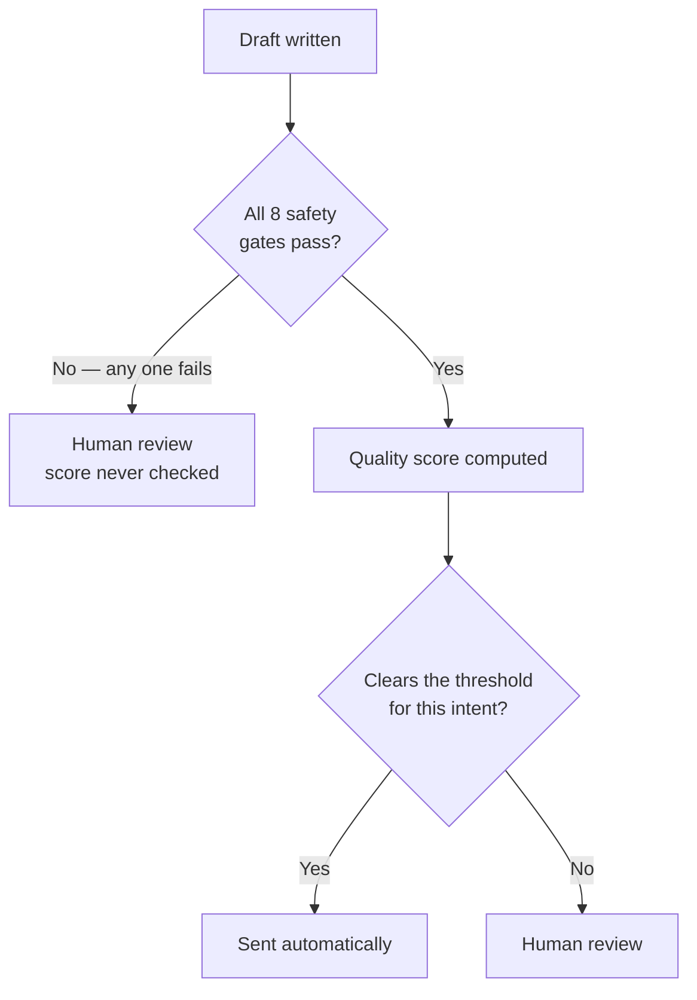
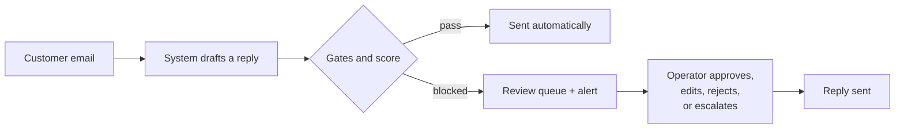

# Business Requirements Document
# TaskFlow — An AI Customer Support Agent

| | |
|---|---|
| **Document** | Business Requirements Document (BRD) |
| **Project** | TaskFlow — AI Customer Support Agent (Internship POC) |
| **Status** | Proof of Concept, local-first, not deployed to production |
| **Companion** | `PRODUCT_SPECIFICATION.md` — the technical half of this pair |

---

## 1. Executive Summary

TaskFlow is a proof of concept built during an internship. It asks a narrow question: can an AI system take the first pass at answering customer support emails, and reliably recognise the ones it should not answer alone?

The system reads an inbound email, works out what it's about, looks up the relevant policy in a knowledge base, and drafts a reply. Before that reply can be sent automatically it has to pass eight safety gates and clear a quality score. Anything that fails goes to a human reviewer, along with the reason it was stopped.

What this POC demonstrates is the decision mechanism, end to end: email in, decision out, with a record of why. What it does not demonstrate is a production support desk. The knowledge base covers one domain (billing), all data is synthetic, and the whole thing runs on one laptop with a single operator and no hosting.

Everything described in this document was designed and built during the internship. The starting point was an empty repository and a brief.

**Who this is for:** whoever is evaluating the internship — a manager, mentor, or reviewer who wants to know what was built and why, without reading the code.

---

## 2. Business Context

Support teams spend a large share of their time on the same handful of questions: billing queries, refund requests, how to cancel, why was I charged twice. Answering these well means finding the right policy, writing a clear reply, and being consistent about it across a team.

Without a system like this, a person reads every email, decides what it's about, looks up the policy, and writes the reply. That works, but response time depends on staffing, quality depends on who picks up the ticket, and there's no record of why a particular answer was given.

The opportunity is narrow: for questions that are already answerable from existing documentation, a system could draft or send a grounded reply, while routing anything risky — a legal threat, a large refund, an angry customer, a question outside its knowledge — to a person.

This project does not measure business impact. Cost savings and response-time improvements would need a real support queue to measure, and this project doesn't have one.

---

## 3. Problem Statement

From a support manager's point of view:

> Too much of the team's time goes to repetitive, well-documented questions. There's no lightweight way to have a system take a first pass at those that a person can actually trust — one that admits what it doesn't know and never quietly guesses on anything involving money, legal exposure, or policy.

Getting a language model to write a plausible reply is the easy part. Knowing when that reply shouldn't be sent is the hard part, and it's the part this project is actually about.

---

## 4. Objectives

### Primary

* Take a raw customer email through to a decision — either an automatically sent, cited reply, or a review item for a human — with the reasoning recorded.
* Make safety a veto rather than a score component, so a well-written reply can still be blocked when it touches money, legal matters, credentials, or personal data.
* Run the whole pipeline offline against a local model, since cloud API access during an internship isn't guaranteed to last.

### Secondary

* Give an operator a console to review, edit, approve, reject, or escalate anything the system didn't send.
* Record enough per message that any decision can be explained afterwards rather than taken on trust.
* Keep it runnable on one machine with no paid infrastructure, so a reviewer can run it themselves.

---

## 5. Scope

### In Scope

* Inbound email through Gmail, either by checking the inbox on a timer or through Gmail's push notifications.
* Classifying intent into one of eight categories: billing, technical, account, feature request, refund, complaint, general, unknown.
* Looking up knowledge-base content and drafting a cited reply with a language model.
* Eight safety gates that can block an automatic send regardless of how good the draft looks.
* A quality score, applied only to drafts that already passed every gate.
* Automatic sending through the same Gmail account for replies that clear both.
* A review queue with an SLA countdown, and the ability to approve, edit and approve, reject, or escalate.
* Instant alerts to the operator when something needs review, over email, chat, or a webhook.
* A record of every decision, readable through a dashboard or an API.
* A knowledge base covering one product area across seven topics — billing, refunds, cancellations, invoices, pricing, enterprise contracts, and billing troubleshooting — 42 short documents, written synthetically for this project.
* Measurement of how well retrieval, classification, and routing actually perform, against synthetic evaluation sets.

### Out of Scope

* Channels other than email. No live chat, phone, or ticketing integration.
* Knowledge domains other than billing and subscriptions.
* Enforced data isolation between tenants. Every table carries a `tenant_id`, but nothing enforces access control on it.
* More than one reviewer, with distinct permissions.
* Real customer data. Every message, document, and evaluation query is synthetic.
* Hosting anywhere other than a local machine.
* Learning from operator edits. The edits are recorded for this, but no training step was built.

---

## 6. Stakeholders and Users

| Stakeholder | Role | How they interact | What they need |
|---|---|---|---|
| **Support operator** | Actions anything the system didn't send | The dashboard's review queue | To see what was drafted, why it was stopped, and act on it quickly |
| **Customer** | The person asking the question | Sends an email, receives a reply | A correct answer quickly when possible, and never an automated reply that's wrong or invented |
| **Technical reviewer** | Checks the system's behaviour and safety | The API, the decision records, config files, evaluation scripts | To reconstruct why any decision was made, and to confirm the gates can't be bypassed |
| **Internship reviewer** | Assesses what was built | This document, a live demo, the code | An honest demonstration of the mechanism, scoped accurately |

There's no administrator role. Configuration is changed by editing files, not through a UI.

---

## 7. User Requirements

* A customer should be able to send an ordinary support email and, if it's a well-documented question, get an accurate cited reply without waiting for a person.
* A customer should never receive an automated reply that invents information, commits money above an agreed limit, or answers a legal threat as though it were routine.
* An operator should see every pending item in one place, with the original message, the draft, and a plain-language reason it was stopped.
* An operator should be able to approve, edit and approve, reject, or escalate, and have that action recorded against their name.
* An operator should be able to look back at any past message and see what the system did at each step.
* The business should be able to change a policy limit or a quality threshold without an engineering release.
* The system should keep working in reduced form when the primary AI provider is unreachable, rather than stopping.

---

## 8. Key Business Workflows

### How the system decides

Two layers, in a fixed order. The gates run first, and a failure there ends the decision — the quality score is never consulted.

This ordering is the main design decision in the project. If a safety condition were one weighted term among several, a draft that scored well everywhere else could outvote it. As a gate, it can't be outvoted.

### Workflow A — An email answered automatically

1. **Starting condition:** a customer asks a well-documented, low-risk question, such as which payment methods are accepted.
2. **User action:** none. The email is the trigger.
3. **System behaviour:** classify, retrieve the relevant policy, draft a reply citing it, run the gates, compute the score. All pass.
4. **Result:** the customer gets a reply in a few seconds. No person was involved.

### Workflow B — An email that needs a human

1. **Starting condition:** the email touches something sensitive — a $750 refund, a threat of legal action — or asks something the knowledge base doesn't cover.
2. **User action:** none.
3. **System behaviour:** the system still classifies and drafts internally, but a gate blocks the send. The item goes to the review queue with an SLA deadline, and an alert fires.
4. **Result:** no automated reply goes out. An operator reviews the draft and the reason, then decides.

### Workflow C — Operator review

1. **Starting condition:** items are waiting in the queue.
2. **User action:** the operator opens the dashboard, picks an item, and reads the message, the draft, and the reason it was stopped.
3. **System behaviour:** shows which gates passed or failed, the citations used, and the score against the threshold for that intent.
4. **Result:** the operator sends, edits and sends, rejects, or escalates. The action and any edit are recorded permanently.

An item that nobody actions before its SLA deadline is escalated automatically, so nothing sits unnoticed.

---

## 9. Functional Business Requirements

| ID | Requirement | Priority | Description |
|---|---|---|---|
| BR-01 | Classify inbound email | High | Determine what an email is about before deciding how to handle it. |
| BR-02 | Ground every reply | High | Any automatic reply must be based on knowledge-base content, and cite the document it came from. |
| BR-03 | Safety veto | High | A fixed set of safety conditions must be able to block an automatic send outright, independent of draft quality. |
| BR-04 | Quality bar per topic | High | Beyond safety, a reply must clear a minimum quality bar to send automatically, and that bar must be stricter for higher-stakes topics such as refunds. |
| BR-05 | Human fallback | High | Anything not sent automatically goes to a person. Nothing is dropped, and nothing is sent anyway. |
| BR-06 | Explain any decision | High | For any handled message, the business must be able to see what the system did at each step and why it decided as it did. |
| BR-07 | Review deadlines | Medium | Pending items carry a deadline appropriate to the topic, and overdue items are escalated. |
| BR-08 | Notify a human | Medium | A person is alerted when something needs attention, rather than having to watch a dashboard. |
| BR-09 | Degraded operation | Medium | The system continues to function in reduced form when the primary AI provider is unreachable. |
| BR-10 | No duplicate replies | Medium | The same inbound email is never answered twice, even if delivered more than once. |
| BR-11 | Protect personal data | High | Personal or sensitive information in a customer's message must not reach an external AI provider, an alert channel, or a log in readable form. |
| BR-12 | Business-changeable limits | Medium | Policy limits and quality thresholds must be changeable by the business without an engineering release. |

---

## 10. Success Criteria

This is a POC, so success is whether the mechanism works and behaves safely, not a business metric that would need a live queue to measure.

* A set of test emails produces the expected outcome — sent or escalated — for the expected reason, repeatably.
* A deliberately risky email is blocked even when the quality score alone would have cleared the bar, demonstrating that the gate is a genuine veto.
* A question the knowledge base can't answer is escalated rather than answered with something invented.
* The system runs end to end with no internet connection, using a local model.
* An operator can action an item from the dashboard without touching the database or the code.
* Any outcome in a demo can be explained by pointing at that message's record.

### What was actually measured

These are the numbers the evaluation scripts produced. Sample sizes are small and the data is synthetic; they're included because measured beats asserted, not because they'd survive a production review.

| Area | Result | Sample | Caveat |
|---|---|---|---|
| Retrieval | Recall@5 92.9%, Recall@1 69.2%, MRR@10 0.79 | 351 distinct queries with per-query ground truth | Synthetic corpus, four difficulty tiers |
| Routing / drafting | 50% auto-sent, 50% escalated; mean quality score 0.771 | 8 queries through the real pipeline | Very small sample; useful as a smoke test, not a rate |
| Classification | 100% accuracy, macro F1 1.0 | 14 samples | **Offline keyword fallback only.** The LLM classification path has not been scored against this set |
| Score calibration | No change recommended | 8 usable samples | The tool declines to fit weights on a sample this small |
| Automated tests | 191 passing | unit, integration, pipeline, end-to-end | Asserts routing decisions and reason codes, never generated prose |

The classification and calibration rows are the weakest evidence here and are labelled as such rather than rounded up.

---

## 11. Assumptions and Constraints

**Assumptions**

* The Gmail account is a dedicated test mailbox, not a live customer inbox.
* All data is synthetic and created for this project. No real customer data is used anywhere.
* One operator works the queue at a time. Concurrent review was not a design goal.
* Whoever runs it has at least one working AI provider, cloud or local.

**Constraints**

* One machine, no external servers, containers, or hosted databases. This was a simplicity constraint, not a scalability judgement.
* Cloud API access may be temporary, which is why the local fallback exists at all.
* Development time was one internship, which shaped what was built versus documented as a next step.

**Dependencies**

* A Gmail account for sending and receiving.
* At least one reachable AI provider: OpenRouter, Anthropic Claude, or a local Ollama model.
* For push-based email delivery instead of timed checking, a Google Cloud project with the Gmail and Pub/Sub APIs enabled. This is a one-time manual setup, documented in `docs/14_GMAIL_PUSH_SETUP.md`. It has been completed and confirmed with a real inbound email; timed checking remains the default and needs no setup.

---

## 12. Risks and Future Considerations

**Limitations observed while building this**

* The knowledge base covers billing only. Anything else is escalated rather than answered, which is the safe outcome but makes the automatic-reply capability narrower than "customer support agent" suggests.
* The quality-score weights were set by hand, not learned. A calibration tool exists but there isn't enough reviewed history yet for it to produce a result worth using.
* All measurement is against synthetic data, so the numbers describe behaviour on synthetic data. Real traffic would differ.
* Personal-data redaction catches fixed formats such as card numbers, social security numbers, and API keys, and now also names, email addresses, and phone numbers. It is not exhaustive, and the name detection needed a list of known product terms to stop it flagging the product's own name as a person's.

**Future considerations** *(not built — see `PRODUCT_SPECIFICATION.md` §14 for the full list)*

* Extending the knowledge base beyond billing.
* Learning the score weights from real reviewed outcomes once enough exist.
* More than one operator, with permissions.
* Enforcing tenant isolation on the `tenant_id` that every table already carries.
* Channels beyond email.
* Fine-tuning on the operator edits the system already records.
