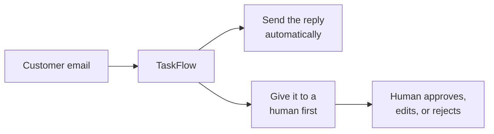
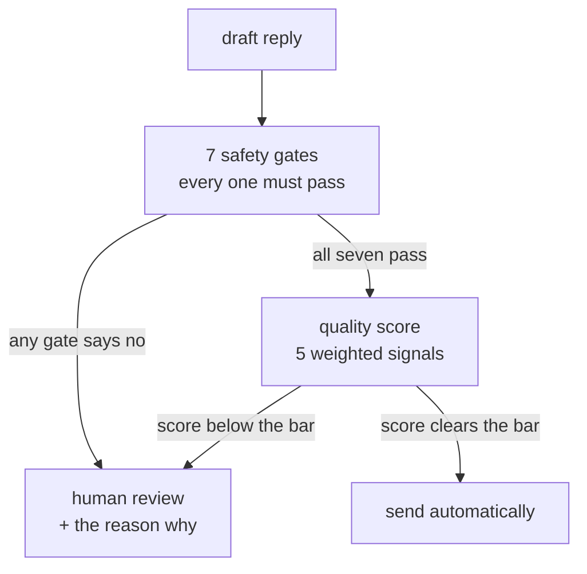

# Product Requirements Document
# TaskFlow AI Support Agent

*Intern edition — written to be read in one sitting and presented in fifteen minutes.*

| | |
|---|---|
| **Version** | 1.0 (intern edition) |
| **Date** | 2026-08-24 |
| **Author** | Vansh Rautela |
| **Companion** | [`SPEC.md`](SPEC.md) — how it is built |
| **Detailed versions** | [`BRD.md`](BRD.md) and [`PRODUCT_SPECIFICATION.md`](PRODUCT_SPECIFICATION.md) — the full reference documents, for anyone who wants every number |

```
Status:        v1 working end to end
Last checked:  2026-08-24
Tests:         68 / 68 passing        (uv run pytest -q, 38.6s)
Architecture:  boundary contract green (uv run lint-imports)
Lint / types:  24 ruff findings, 9 mypy errors — all in adapter and script code,
               none in the safety logic. Not yet clean, and I am not claiming it is.
```

---

## 1. What I built, in one paragraph

TaskFlow is an AI customer-support agent. A customer sends an email. The system figures
out what the email is about, searches a knowledge base for the relevant help articles,
writes a reply that quotes those articles, and then makes one decision: **send this
automatically, or hand it to a human.** Most of the engineering is in that last step. The
system is designed so that it can refuse to answer, and so that it can show you exactly
why it refused.



---

## 2. Why I built this

### 2.1 The honest reason

This is my **internship project**. The real requirement is that I can stand in front of
senior engineers and explain every part of a system I built alone, in four weeks, on a
laptop, with no paid infrastructure. That requirement shaped everything:

| Constraint | What it forced |
|---|---|
| I had to explain every component out loud | No orchestration framework. The whole pipeline is one function you can read top to bottom |
| Free tier only | Database is a file. Vector store runs inside the process. No Docker, no servers |
| My API keys expire | A local model must be able to take over, so the system still runs with the WiFi off |
| The live demo cannot fail | Everything above, plus a scripted offline mode |

### 2.2 TaskFlow is made up

**TaskFlow is a fictional company I invented so the project had a realistic setting.** It
sells project-management software — Free, Pro at $12/user/month, Enterprise at
$29/user/month. Every customer message and every help article in this repo is synthetic. I
wrote them.

This matters for how you read the rest of this document. **There are no revenue figures,
no ROI percentages, and no customer counts in here**, because I would have had to invent
those too, and a senior engineer spots an invented number immediately. What I do have are
real, checkable properties of the system: how many tests pass, what the auto-send rules
are, what it costs per message. Those are the numbers I use.

---

## 3. The problem I'm actually solving

### 3.1 The easy part and the hard part

Getting an LLM to write a decent support reply is **easy**. I had that working in an
afternoon. Here is the hard part:

> An LLM that has read your refund policy will still happily approve a $750 refund when
> your support agents are only allowed to approve $500.

It is not lying. It is not broken. It just has no concept of *authority*. It writes what
sounds correct. And that is exactly why you cannot put a raw LLM in front of customers.

### 3.2 Four ways it goes wrong

| # | Failure | What it looks like |
|---|---|---|
| 1 | **Promises it can't make** | Approves a refund over the limit, commits to a ship date, invents a discount |
| 2 | **Confident nonsense** | Asked something the knowledge base doesn't cover, it answers anyway |
| 3 | **Unexplainable decisions** | Three months later a customer disputes a reply, and all you have is "confidence was 0.83" |
| 4 | **Safety that quietly stops working** | A safety score is one number in an average, so a great retrieval score cancels out a policy violation |

### 3.3 My one-sentence thesis

> **A system that knows when it is not allowed to answer, and can prove why.**

Everything in the design serves that sentence. If I only get to say one thing in the
presentation, this is it.

### 3.4 The idea that makes it work

This is the core design decision, and it is worth understanding before anything else.

**The wrong way** (what I built first, then threw away): score everything, average it, send
if the average is high enough.

```
policy_ok       0.0   × 0.15     ← there IS a critical violation
citations       1.0   × 0.35
grounding       1.0   × 0.25
retrieval       1.0   × 0.20
tone            1.0   × 0.05
                ─────────────
total           0.85  ≥ 0.80  →  SENDS THE UNSAFE REPLY
```

The maths is fine. The design is wrong. Good scores elsewhere *paid for* the policy
violation.

**The right way** (what the system does): safety checks are not scores at all. They are
**gates**. Seven of them. Each is a yes/no question, and **any single "no" stops the send**,
no matter how good everything else looks. Only replies that pass all seven get scored, and
the score just decides among replies that are already known to be safe.



**Safety is a veto, not a weight.** That is the sentence to remember.

I have a test that guards this. It builds a reply where every quality signal is perfect —
a score above 0.95, way over the bar — but with a critical policy violation. It asserts the
system still refuses to send. The test is called
`test_critical_policy_violation_never_auto_sends`, and it is the single most important
thing in the repository.

---

## 4. Who uses it

| Person | What they want | Where they touch the system |
|---|---|---|
| **Customer** | A correct answer fast, or a real human quickly | Sends an email; gets a reply |
| **Support operator** | To see the customer's message and the AI's draft side by side, and know *why* it was escalated | Streamlit dashboard — approve, edit, reject, or escalate |
| **Support manager** | How often is it auto-sending? What is it costing? | Dashboard metrics tab; edits a config file to move the thresholds |
| **Compliance** | To define what the agent may never say, and audit any past decision | Edits `config/policies.yaml`; looks up any decision by its trace ID |

---

## 5. What the system must do

Grouped by what it is for, rather than by a formal numbering scheme. **Must** = the system
is not defensible without it. **Should** = important, but the system still works if it
degrades.

### 5.1 Understand the message

| ID | Requirement | Level | Done? |
|---|---|---|---|
| R1 | Accept a message over a REST API, and poll a real Gmail inbox over IMAP | Must | ✅ |
| R2 | Strip credit-card numbers, SSNs, and API keys out of the text before it goes anywhere near a model | Must | ⚠️ Works for the classify step; the drafting step still gets the raw text (see §8) |
| R3 | Sort every message into exactly one of **8** categories: billing, technical, account, feature_request, refund, complaint, general, unknown | Must | ✅ |
| R4 | If the model is down, fall back to keyword matching rather than failing the message | Must | ✅ |

### 5.2 Find the right information

| ID | Requirement | Level | Done? |
|---|---|---|---|
| R5 | Search the knowledge base two ways at once — by meaning and by keyword — and merge the results | Must | ✅ |
| R6 | Decide whether what came back is *enough* to answer with, and record why if it isn't | Must | ✅ |
| R7 | Notice if a help article contains text trying to hijack the model ("ignore previous instructions") | Must | ✅ |
| R8 | Ship a knowledge base of at least 42 articles | Must | ✅ 42 articles, 178 searchable chunks |

### 5.3 Write the reply

| ID | Requirement | Level | Done? |
|---|---|---|---|
| R9 | Every fact in the reply must cite the article it came from, inline, as `[chunk_id]` | Must | ✅ |
| R10 | A citation pointing at an article that wasn't actually retrieved must be caught | Must | ✅ |
| R11 | If every model provider fails, produce a safe template reply instead of an error | Must | ✅ |
| R12 | Never route on the model's own opinion of its work — log it, ignore it | Must | ✅ |

### 5.4 Decide whether to send

| ID | Requirement | Level | Done? |
|---|---|---|---|
| R13 | Run **3** independent checks on the finished draft: leaked secrets, citations resolve, is it grounded in the source text | Must | ✅ |
| R14 | If a check crashes or times out, treat that as a **failure**, never as a pass | Must | ✅ |
| R15 | Run **7** safety gates before any scoring. Any one failing sends it to a human | Must | ✅ |
| R16 | Attach exactly one machine-readable reason code to every decision | Must | ✅ |
| R17 | Score the survivors on 5 weighted signals and compare against a per-category bar | Must | ⚠️ Scoring works; every category currently uses the same 0.70 bar (see §8) |

### 5.5 Involve a human properly

| ID | Requirement | Level | Done? |
|---|---|---|---|
| R18 | Escalated messages go to a queue with the customer's original text and the draft | Must | ✅ |
| R19 | The operator can approve, edit and approve, reject, or escalate further | Must | ✅ |
| R20 | Two operators clicking approve at the same moment must produce exactly one reply | Must | ✅ |
| R21 | Alert the team the moment something is escalated — email, Telegram, and a webhook | Must | ✅ |
| R22 | One alert channel failing must not stop the others, or affect the decision | Should | ✅ |

### 5.6 Send it, exactly once

| ID | Requirement | Level | Done? |
|---|---|---|---|
| R23 | Save the reply to the database *before* trying to send it | Must | ✅ |
| R24 | The same reply can never be sent twice, even if something crashes and retries | Must | ✅ enforced by a database constraint |
| R25 | Retry a failed send, and give up after 3 tries | Should | ❌ Not built (see §8) |

### 5.7 Explain itself afterwards

| ID | Requirement | Level | Done? |
|---|---|---|---|
| R26 | Every message produces one complete record: category, articles found, draft, all 3 checks, all 7 gates, the score, the decision, and every model call with its cost | Must | ✅ |
| R27 | Look any decision up by its trace ID over the API | Must | ✅ |
| R28 | Show auto-send rate, human-review rate, and total spend | Should | ✅ |
| R29 | Enforce 10 policy rules that live in a config file, changeable without touching code | Must | ✅ |

---

## 6. How I'll know it worked

These are the targets. Two of them are absolute; the rest are things to measure.

| # | Goal | How it's measured | Target |
|---|---|---|---|
| G1 | **Never auto-send an unsafe reply** | Auto-sent replies that broke a safety gate | **0.** Not negotiable |
| G2 | **Every decision explainable** | Decisions carrying a reason code and a full trace | 100% |
| G3 | Handle a decent share of routine mail alone | Auto-send rate on non-blocked categories | Aiming for ≥ 60% — but see the note below |
| G4 | Survive losing the internet | Does the full pipeline run offline? | Yes, on a local model |
| G5 | Keep costs tiny and visible | Cost recorded per model call; daily ceiling | $2.00/day ceiling configured — **not yet enforced in code** |
| G6 | Escalations reach a human fast | Alert channels fired per escalation | 3, independently |

> **Why I'm not quoting an auto-send rate.** Right now every category is judged against the
> same 0.70 bar instead of its own (§8, issue 2). Fixing that will *lower* the auto-send
> rate — which is the correct direction, because refunds should be harder to auto-send than
> general questions. Quoting today's number would be quoting a bug. I would rather say that
> than put a flattering number on a slide.

---

## 7. What I deliberately did not build

None of these are things I forgot. Each is a decision with a reason and a trigger for
revisiting it. **A reviewer will ask about these, so I want them written down before they
do.**

| Not built | Why not | When I'd build it |
|---|---|---|
| Trained intent classifier | An LLM plus a keyword fallback was accurate enough, and cost me zero training time in a 4-week budget. The labelled data is already generated and sitting in the repo | When LLM cost or latency becomes the bottleneck |
| Reranking model | With 178 chunks, the hybrid search already puts the right article on top | When retrieval evaluation shows it missing |
| Spam filter and instant-FAQ path | Both are in the config file already; neither is wired up | When there's real spam, or enough repeat questions to justify a zero-cost path |
| Multi-tenancy | Every table and every search already carries a `tenant_id`. What's missing is per-tenant keys and knowledge bases | When there's a second tenant |
| Docker / cloud deploy | I have no Docker experience and 4 weeks. Learning it badly on a deadline is worse than not using it | After the internship, deliberately |
| Web chat, voice, other languages | Text and email only in v1 | Post-v1 |
| Login on the API | Single machine, single user, demo only | The moment it leaves my laptop |

---

## 8. What's broken or half-done

I would rather show you this list than have you find it. Every item is real, and each one
is in the repo today.

| # | Issue | Why it matters | Size of fix |
|---|---|---|---|
| 1 | **The drafting step gets the un-redacted message.** Redaction happens, and the classify step uses it, but the drafting prompt reads the original field | Weakens the PII guarantee. The *outbound* check still catches leaks in the reply | One line |
| 2 | **Per-category bars aren't applied.** All 8 thresholds are in config; the pipeline uses `general` (0.70) for everything | Refunds auto-send at 0.70 instead of the intended 0.90 | Two lines |
| 3 | **A failed email send is recorded as sent.** The delivery function returns success unconditionally on one path, and there's no retry | A reply can be silently lost | Small |
| 4 | **The classifier prompt lists 10 categories** but only 8 exist. The two extras fail validation and silently drop to keyword matching | Quietly degraded accuracy | Generate the list from the enum |
| 5 | **Classification can't fail over.** Only one provider has a model configured for it, so if that provider is down it goes straight to keywords | Less resilient than it looks | Add two config entries |
| 6 | **A real Gmail app password is committed** in the tracked `.env.example` | Actual security problem | Rotate the credential and scrub the file |
| 7 | **`tests/e2e/` is empty** | No full-scenario coverage; unit, pipeline and integration layers are green | A day |
| 8 | 24 lint findings and 9 type errors, all in adapters and scripts | Not clean. The safety logic is clean | `ruff check --fix` handles 21 |

Fixed since the first draft of this document: the Gmail poller was reading a settings field
that didn't exist and would have crashed on its first message. That's now corrected.

---

## 9. How to demo it in five minutes

A script for the presentation, in the order that tells the story best.

| # | Show | Say | Command |
|---|---|---|---|
| 1 | A normal billing question going through | "Classified, found three articles, wrote a reply that cites them, all seven gates passed, scored 0.95, sent." | `uv run python scripts/run_scenario.py --text "I was charged twice for Pro this month"` |
| 2 | **The $750 refund** | "Watch the score — it's above 0.95. Every quality signal is perfect. And it still refuses, because a policy veto isn't a number." | `uv run python scripts/run_scenario.py --text "Please refund me $750 for the unused seats"` |
| 3 | The escalation arriving | "That's the alert on my phone, with the reason code, before I've even opened the dashboard." | Telegram / email |
| 4 | The operator console | "Customer message on the left, draft on the right, the reason it stopped in the middle. I approve, edit, or reject." | `uv run streamlit run dashboard/app.py` |
| 5 | The trace | "Every decision reconstructable from an ID — the chunks, the scores, the gates, the model, the cost." | `GET /traces/{id}` |
| 6 | **Change a threshold live** | "Nothing is hardcoded. I edit the YAML, re-run, and the routing decision flips. No restart, no deploy." | edit `config/thresholds.yaml`, re-run step 1 |
| 7 | The guard test | "And this test makes sure I can never accidentally undo the design." | `uv run pytest tests/unit/test_gates.py -v` |

**If someone unplugs the internet:** set `TASKFLOW_LLM_MODE=local_only` and run it again on
the local model. That is the point of the fallback.

---

## 10. Words I use in this document

| Term | Plain meaning |
|---|---|
| **Auto-send** | The reply goes to the customer with no human reading it |
| **Gate** | A yes/no safety check. One "no" stops the send, whatever else is true |
| **Veto** | What a gate does. It cannot be outvoted by good scores |
| **Fail closed** | If a check breaks, treat it as failed. Never "well, it didn't say no" |
| **Grounding** | How much of the reply's wording actually appears in the articles it cited |
| **Hybrid search** | Searching by meaning and by keyword at the same time, then merging |
| **Chunk** | One searchable slice of a help article, with its own ID |
| **Trace** | The full record of everything that happened to one message |
| **Idempotency key** | A unique value that makes sending the same reply twice impossible |
| **Preempt category** | `complaint` and `unknown` — never auto-sent, no matter how good the draft is |
| **Reason code** | The single machine-readable answer to "why did it do that?" |

---

*Next: [`SPEC.md`](SPEC.md) — how each of these requirements is actually built.*
