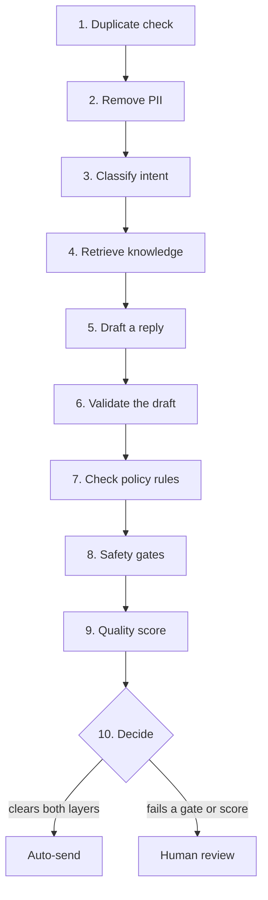
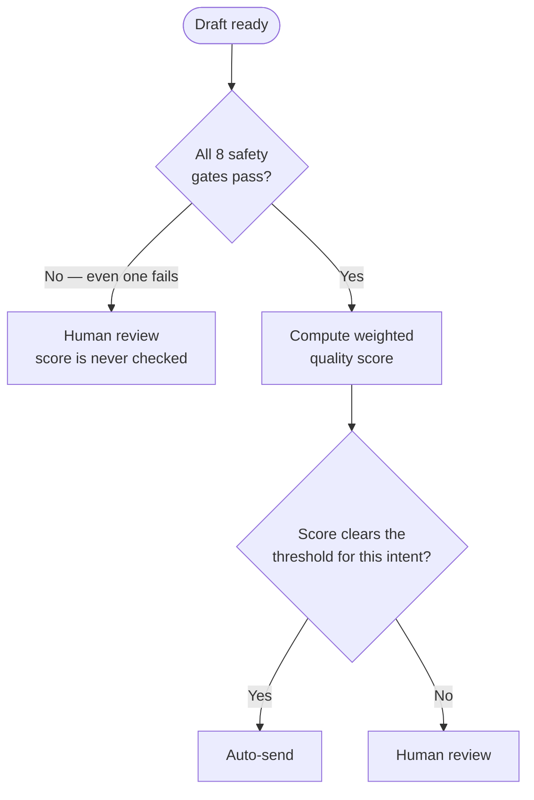
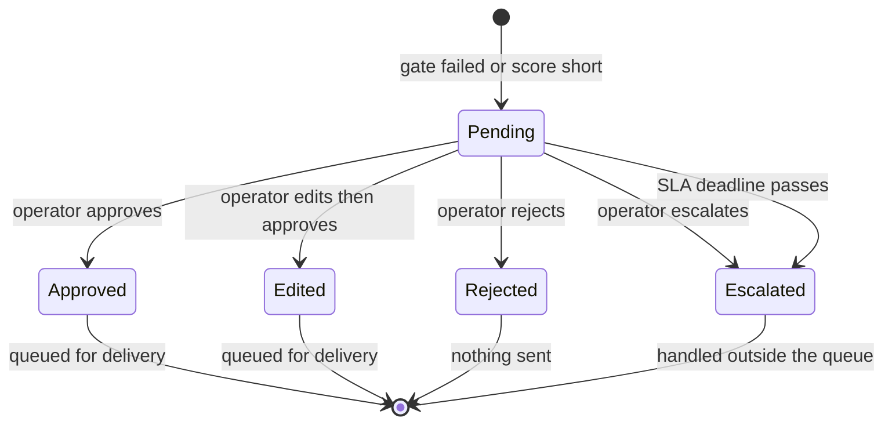
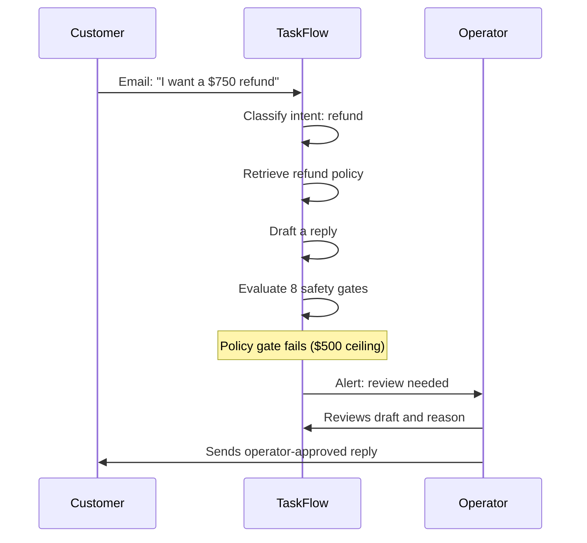
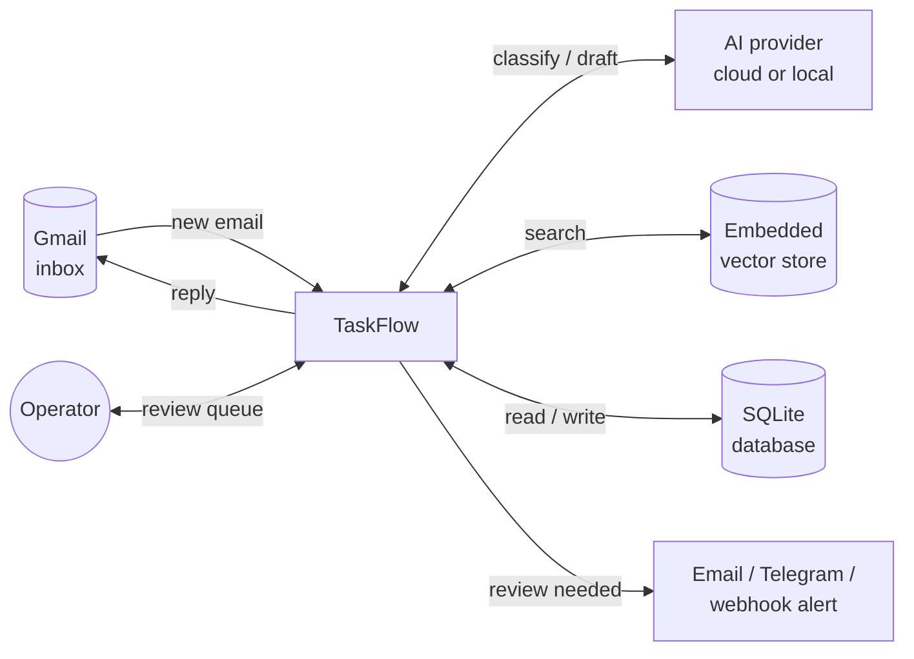

# Product Specification Document
# TaskFlow — An AI Customer Support Agent

| | |
|---|---|
| **Document** | Product Specification Document (PSD) |
| **Project** | TaskFlow — AI Customer Support Agent (Internship POC) |
| **Companion document** | `BRD.md` — read that first for the business framing |

---

## 1. Product Overview

**Name:** TaskFlow

**Purpose:** TaskFlow reads an inbound customer support email, decides what it's about, drafts a reply grounded in a knowledge base, and either sends that reply automatically or routes it to a human — based on a two-layer decision process described in Section 5.

**Problem addressed:** repetitive, well-documented support questions currently require a human to read, research, and answer each one individually. TaskFlow automates the parts of that process that are safe to automate, and is explicitly designed to recognize the parts that aren't.

**Target users:** a support operator who reviews escalated items, and customers who email the support address and receive either an automated or an operator-sent reply. See Section 4 for the full role breakdown.

**Current status:** proof of concept. Runs locally on one machine, uses a synthetic knowledge base and synthetic test data, and has not been deployed or connected to a real support inbox.

---

## 2. Product Goals

These mirror the objectives in the BRD, restated in product terms:

1. Correctly classify an inbound email's intent and retrieve the knowledge-base content actually relevant to it.
2. Draft a reply that only states things the retrieved content supports, with citations.
3. Apply a fixed set of safety checks that can block an automatic send outright — independent of, and evaluated before, any quality scoring.
4. Score the remaining quality of a draft that passed every safety check, and compare that score against a bar that's set per topic (a refund reply needs a higher bar than a general question).
5. Give an operator everything they need to review, correct, and action anything the system didn't send on its own.
6. Record enough detail about every decision that it can be explained after the fact without guessing.

---

## 3. Product Scope

### Current functionality

* Email ingestion via Gmail — either periodic inbox checking (IMAP) or Google's push-notification API.
* Intent classification across 8 categories.
* Retrieval from a 42-document knowledge base (billing/subscriptions domain) using a hybrid search method (see Section 10).
* Reply drafting with citations, using a cloud or local language model.
* Eight safety checks ("gates") and a five-signal weighted quality score.
* Automatic email delivery for replies that clear both layers.
* A review queue with SLA deadlines, instant alerts, and four operator actions (approve, edit-and-approve, reject, escalate).
* A dashboard for operators (review queue, trace explorer, basic metrics).
* A REST API exposing the same operations programmatically.
* A background worker that delivers approved/auto-sent replies, and a sweeper that escalates anything that misses its SLA.
* Evaluation scripts that measure classifier accuracy, retrieval quality, and (experimentally) whether the scoring weights could be tuned from outcome data.

### POC boundaries

* Single machine, single operator, single knowledge domain, single Gmail account.
* No user accounts or login system — the API is protected by one shared bearer token, and the dashboard has no authentication of its own.
* No mobile interface — the dashboard is a desktop web page (Streamlit).

### Out-of-scope functionality

Channels other than email, multiple operators with permissions, learning from operator corrections, and every production deployment concern (containerization, managed database, tenant isolation enforcement). Section 13 covers each of these and why, so they aren't restated here.

---

## 4. User Roles

| Role | Responsibilities | Interaction points |
|---|---|---|
| **Customer** | Sends a question by email; does nothing else | Their email client only — no direct interaction with any TaskFlow interface |
| **Support operator** | Reviews escalated items; approves, edits, rejects, or escalates them | Streamlit dashboard (primary); REST API (equivalent actions, for scripted or programmatic use) |
| **Technical reviewer / maintainer** | Configures thresholds and policy rules; runs evaluation scripts; inspects traces to verify behaviour | Configuration files (YAML), CLI scripts, the API's trace and metrics endpoints |

There is no separate "admin" role in the product itself — configuration is done by editing files, not through a settings screen.

---

## 5. Core Features

Every inbound message moves through the same fixed sequence of stages. The features below correspond to specific stages in this sequence:

Stages 1–2 are housekeeping (don't process the same email twice, and strip anything sensitive before it goes further). Stages 3–5 are where the AI does its work. Stages 6–9 are where the system checks that work before trusting it. Stage 10 is the actual routing decision, covered in detail in the next two features.

### Feature: Intent Classification

**Purpose:** Determine what an inbound email is about, so retrieval and scoring can use the right rules for that topic.

**User interaction:** None directly — this runs automatically the moment an email is ingested.

**System behaviour:** The message text is sent to a language model with a fixed set of 8 possible categories (billing, technical, account, feature_request, refund, complaint, general, unknown) and asked to pick one with a confidence value. If no AI provider is reachable, a simpler keyword-matching fallback picks a category instead, at a deliberately lower confidence.

**Expected result:** An intent label and a confidence score, both recorded on the trace and used by every later stage.

### Feature: Knowledge Retrieval

**Purpose:** Find the knowledge-base passages actually relevant to the customer's question, so the draft has something real to cite.

**User interaction:** None directly.

**System behaviour:** The question is searched against the knowledge base two ways at once — a meaning-based (embedding) search and a keyword-based search — and the two result sets are merged. The merged candidates are then re-ranked by a second, more precise model, and the system checks whether the best match is actually good enough to be useful (rather than just the "least bad" result).

**Expected result:** A ranked set of knowledge-base passages, plus a yes/no judgment on whether retrieval found enough to answer confidently.

### Feature: Draft Generation

**Purpose:** Write a reply to the customer, using only the retrieved passages as its source of facts.

**User interaction:** None directly. The operator sees and can edit the result later, in the Human Review Console below.

**System behaviour:** A language model is given the customer's message and the retrieved passages, and asked to write a reply that cites the specific passage it's drawing each claim from. If no AI provider responds successfully, a generic holding-message template is used instead — and this fact is recorded, because a template reply must never be treated as if a model actually answered the question.

**Expected result:** A draft reply with a tone label, a complexity label, and a list of citations (which may be empty).

### Feature: Safety Gates

**Purpose:** Block an automatic send outright when a draft touches something the system should never decide alone — regardless of how well-written it otherwise is.

**User interaction:** None directly, but the outcome (which gate failed, if any) is shown to the operator.

**System behaviour:** Eight independent checks run: a policy-rule check (e.g., a refund over the agreed limit, a legal threat, a request for credentials), a check that no personal data leaked into the draft, a check that every citation actually points at a real retrieved passage, a check that the topic itself isn't one the system should never auto-answer (complaints, unclear intent), a check that the classifier was confident enough, a check that none of the other checks crashed or timed out, a check for suspicious "instructions" hidden in retrieved content, and a check for whether a real model wrote the reply at all (versus the fallback template). If **any** of these fail, the message is routed to human review, and the quality score described next is never allowed to override that.

**Expected result:** A pass/fail result per gate, and, if any failed, a routing decision of `HUMAN_REVIEW` with a plain-language reason.

### Feature: Quality Scoring

**Purpose:** For drafts that passed every gate, judge whether the draft is good enough to send without a person looking at it.

**User interaction:** None directly; the score and the bar it needed to clear are both shown to the operator when relevant.

**System behaviour:** Five signals are combined into a single number between 0 and 1: how well the citations resolve, how well the claims are actually supported by the cited text, how relevant the retrieved passages were, how confident the classifier was, and whether the tone matches the situation. That number is compared against a bar that depends on the topic — a general question needs a lower bar (0.70) than a refund (0.90), and two topics (complaint, unknown) have a bar set above the maximum possible score, so they can never pass on score alone even if a gate somehow didn't catch them.

**Expected result:** A numeric score, the bar it was compared against, and — combined with the gate results — a final routing decision of `AUTO_SEND` or `HUMAN_REVIEW`.

**Why these are two layers and not one:** a score is a compromise between competing signals. A safety rule isn't. If "don't promise a refund over the ceiling" were one weighted term, a draft that scored well on citations, grounding, and tone could outvote it and send anyway. The gate can't be outvoted, because it runs first and short-circuits the decision.

### Feature: Human Review Console

**Purpose:** Give an operator everything needed to act on anything the system didn't send automatically.

**User interaction:** The operator opens the dashboard, picks an item from the queue, reads the customer's message and the draft, sees which gates passed or failed and the score, and clicks Approve, Save & Approve (after editing the draft text), Reject, or Escalate.

**System behaviour:** The chosen action is recorded (including the edited text and the reason given, if any), the item's status changes accordingly, and — for approve/edit — the reply is placed in the delivery queue for the background worker to actually send.

**Expected result:** The item leaves the pending queue, an audit record is created, and (for approve/edit) the customer eventually receives a reply.

A review item moves through these states. Only one operator can action an item — the database update is written so the second attempt loses cleanly rather than double-sending.

### Feature: Delivery and Alerting

**Purpose:** Actually get an approved or auto-sent reply into the customer's inbox, and make sure a human finds out promptly when something needs attention.

**User interaction:** None for delivery. For alerts, the operator receives an email and/or a Telegram message.

**System behaviour:** A background worker continuously checks for queued replies and sends them by email, only marking a message as sent once the mail server confirms it was accepted — a failed send stays queued and is retried, never silently marked as delivered. Separately, the moment an item is queued for human review, an alert fires on every configured channel (email, Telegram, or a generic webhook) at once.

**Expected result:** A delivered email with a real delivery confirmation on success, or a retry on failure; an alert notification within seconds of an item needing review.

---

## 6. Functional Requirements

| ID | Feature | Requirement | Priority |
|---|---|---|---|
| FR-01 | Classification | Classify every inbound message into one of 8 defined intents, with a confidence value | High |
| FR-02 | Classification | Fall back to keyword-based classification if no AI provider is reachable | Medium |
| FR-03 | Retrieval | Search the knowledge base using both meaning-based and keyword-based methods and merge the results | High |
| FR-04 | Retrieval | Re-rank merged results and judge whether the best result is actually good enough to answer from | High |
| FR-05 | Drafting | Generate a reply that cites the specific knowledge-base passage behind each claim | High |
| FR-06 | Drafting | Use a safe holding-message template, clearly flagged as such, if no AI provider responds | High |
| FR-07 | Safety | Evaluate all 8 safety gates before any score is computed, and block auto-send if any fail | High |
| FR-08 | Scoring | Compute a weighted quality score from 5 signals, only for gate-passing drafts | High |
| FR-09 | Scoring | Compare the score against a threshold specific to the message's intent | High |
| FR-10 | Delivery | Send an auto-approved or operator-approved reply by email, and only mark it sent on a real delivery confirmation | High |
| FR-11 | Review | Let an operator approve, edit-and-approve, reject, or escalate a pending item | High |
| FR-12 | Review | Track an SLA deadline per pending item, and auto-escalate anything that passes it | Medium |
| FR-13 | Alerting | Notify a human (email/Telegram/webhook) the moment an item needs review | Medium |
| FR-14 | Observability | Record a full trace of every stage's output for every processed message | High |
| FR-15 | Observability | Expose recent traces, pending reviews, and basic aggregate metrics via API and dashboard | Medium |
| FR-16 | Data protection | Redact recognizable PII (card numbers, SSNs, API keys/tokens) before any text leaves the process | High |
| FR-17 | Deduplication | Never process the same inbound message twice | Medium |
| FR-18 | Configuration | Read scoring weights, thresholds, and policy rules from configuration files, not code | Medium |

---

## 7. User Flows / Operational Scenarios

### Scenario: A routine question gets answered automatically

1. A customer emails asking what payment methods are accepted.
2. TaskFlow classifies this as a `billing` question with high confidence.
3. Retrieval finds a clearly relevant knowledge-base passage about accepted payment methods.
4. A draft is generated, citing that passage.
5. All 8 gates pass (nothing risky here), and the quality score clears the 0.80 bar set for billing questions.
6. The reply is queued for delivery and sent within seconds; the customer sees a normal reply in their inbox, with no indication a person wasn't involved.

### Scenario: A large refund request is correctly blocked

1. A customer emails asking for a $750 refund.
2. TaskFlow classifies this as `refund` and drafts a response.
3. The policy-rule gate detects that the reply (or the request) involves an amount over the $500 agent ceiling, and fails.
4. Because a gate failed, the system does **not** check the quality score at all — the item is routed to human review immediately.
5. An alert fires; an operator opens the dashboard, sees the $500-ceiling policy violation flagged clearly, and decides whether to approve a smaller amount, escalate to finance, or reply manually.

### Scenario: A question outside the knowledge base

1. A customer asks a question about a topic the knowledge base doesn't cover (the current knowledge base is billing-only, so a technical or product question qualifies).
2. Retrieval finds nothing sufficiently relevant.
3. The draft either has no citations, or the citation-resolution gate fails.
4. The item is routed to human review rather than answered with an unsupported guess.
5. An operator answers manually, outside the system's current knowledge.

---

## 8. User Interface

The operator-facing interface is a single Streamlit dashboard with three tabs.

**Review Queue tab** — the main working screen.
* A dropdown lists every pending item by review ID, customer email, and reason code.
* Selecting an item shows: a metadata bar (customer, review/trace ID, reason code, score vs. threshold), the original customer message, which safety gates passed or failed, any knowledge-base citations the draft used, and an editable text box containing the draft.
* Four buttons act on the selected item: **Approve**, **Save & Approve** (sends the edited text instead of the original), **Reject**, and **Escalate** — each takes an optional free-text note that's recorded in the audit log.

**Trace Explorer tab** — for inspecting what happened on any past message.
* A table of the most recent traces (trace ID, channel, intent, action taken, reason, score, cost).
* Selecting one shows its full underlying record as raw structured data — every stage's output, not just the summary.

**System Metrics tab** — a lightweight operational overview.
* Four headline numbers: total messages processed, percentage auto-sent, percentage sent to human review, and total AI provider spend.
* A bar chart of how many messages fell into each intent category.

There is no customer-facing interface — customers only ever see the resulting email in their own inbox.

---

## 9. Data / Information Requirements

**Major inputs**

* The inbound email itself: sender, subject, body text, and a channel/provider identifier used for deduplication.
* The knowledge base: 42 short Markdown documents, organized by topic (billing, refunds, cancellations, invoices, pricing, enterprise contracts, and billing-related troubleshooting).
* Configuration: scoring weights, per-intent thresholds, policy rules, and provider settings — all in YAML files, not hardcoded.

**Major outputs**

* An outbound email (when auto-sent or operator-approved).
* A trace record per inbound message, capturing intent, retrieval results, the draft, validation results, gate results, the score, and the final decision.
* A review-item record for anything escalated, including its SLA deadline and eventual resolution.
* An edit record whenever an operator changes a draft before sending, capturing both the original and edited text — kept for possible future use in improving draft quality, not currently used for that.

**Important entities/data concepts**

* **Trace** — the full record of everything that happened while processing one message. This is the unit of explainability: any question about "why did the system do X" should be answerable from one trace.
* **Review item** — a message currently or previously awaiting a human decision.
* **Routing decision** — the final `AUTO_SEND` / `HUMAN_REVIEW` outcome, with a machine-readable reason code and a human-readable reason.
* **Knowledge-base chunk** — a retrievable segment of a source document, small enough to cite precisely.

The system stores data in a single local database file and a local vector index — there is no separate reporting warehouse or analytics store.

---

## 10. Integrations and Dependencies

| Dependency | Why it's used |
|---|---|
| **An AI provider** (OpenRouter, Anthropic Claude, or a locally-run Ollama model) | Powers intent classification and reply drafting. Multiple providers exist so the system can fail over from cloud to local rather than stop working if one is unreachable. |
| **Gmail (IMAP + SMTP, or the Gmail API for push)** | The only inbound/outbound channel implemented — chosen because it needs no dedicated infrastructure and is easy to demo with a normal Google account. |
| **An embedded vector search library (Qdrant, running in-process)** | Powers knowledge-base retrieval — runs inside the application with no separate database server to install or host. |
| **A local re-ranking model** | Improves retrieval precision after the initial search, without needing a paid API call for every query. |
| **SQLite** | Stores all structured data (traces, review items, the outbox, audit log). Chosen for simplicity — appropriate for one person using the system at a time, not intended as a scalability decision. |
| **Telegram Bot API / generic webhook (optional)** | Alternative ways to alert a human immediately, in addition to email. |

Nothing here requires a paid hosting account, a container platform, or infrastructure beyond what runs on one machine plus the AI provider's own servers.

---

## 11. Non-Functional Requirements

* **Performance:** No formal performance target was set for this POC. In practice, a full automatic reply (classify → retrieve → draft → validate → score → send) typically completes in a few seconds when using a cloud AI provider; the local fallback model is noticeably slower.
* **Reliability:** Any error, timeout, or ambiguous result is designed to fail toward human review rather than toward an incorrect automatic send — this "fail closed" behaviour is treated as more important than uptime.
* **Security:** Recognizable PII (card numbers, SSNs, API keys/bearer tokens) is redacted before any text is sent to an external AI provider, an alert channel, or a log. API access requires a bearer token. Retrieved knowledge-base content and inbound email text are treated as untrusted data, not as instructions — a suspicious "instruction-like" pattern in either is specifically checked for as one of the eight safety gates.
* **Usability:** The dashboard is meant to be usable by an operator without needing to read code or query the database directly.
* **Maintainability:** Business-tunable values (thresholds, weights, policy rules, model choices) live in configuration files, not in application code, so they can be adjusted without a code change.
* **Scalability:** Explicitly not a design goal for this POC. The system assumes one operator and one machine; nothing about the architecture was validated at higher load.
* **Compatibility:** Built and tested for Python 3.12 on Linux; not tested on other operating systems.

No performance, uptime, or accuracy guarantee is claimed anywhere in this document. Where a number exists it's a measurement on synthetic data, not a promise.

### Measured results

Produced by the evaluation scripts in `scripts/`, written to `docs/metrics/`. Sample sizes are small and everything is synthetic, so these are evidence that the mechanism works, not performance figures.

| Area | Result | Sample | What it doesn't tell you |
|---|---|---|---|
| Retrieval (`eval_retrieval.py`) | Recall@1 69.2%, Recall@3 90.3%, Recall@5 92.9%, MRR@10 0.79 | 351 distinct queries, per-query ground truth, four difficulty tiers | Nothing about real customer phrasing; the corpus was written for this project |
| Retrieval sufficiency | 3.7% of queries declared sufficient but retrieved nothing relevant | same 351 | The threshold behind this is a tuning choice, documented in the report |
| Routing (`eval_drafting.py`) | 50% auto-sent / 50% escalated, mean score 0.771, 0 of 8 drafts fell back to the template | 8 queries through the real pipeline | Eight queries is a smoke test. It is not an auto-send rate |
| Classification (`eval_classifier.py`) | 100% accuracy, macro F1 1.0 | 14 held-out samples | **Only the offline keyword fallback was scored.** The LLM path has not been measured against this set |
| Score calibration (`calibrate_confidence.py`) | No reweighting recommended | 8 usable samples | The tool refuses to fit five weights on eight samples, which is the correct outcome, not a result |
| Test suite | 191 passing | unit, integration, pipeline, e2e | Asserts routing decisions and reason codes, never generated prose |

The classification row is the weakest number in this document. It measures a substring matcher on fourteen examples, and it is reported that way rather than as "the classifier is 100% accurate."

---

## 12. Error Handling and Edge Cases

| Situation | Behaviour |
|---|---|
| The same email is delivered more than once (e.g., a provider retry) | Detected and dropped before any processing happens, using a unique key derived from the message. |
| No AI provider is reachable at all | Classification falls back to keyword matching (at a lower, capped confidence); drafting falls back to a safe holding-message template. Neither fallback is allowed to auto-send — a related safety gate specifically checks whether a real model produced the draft. |
| A validator (citation check, grounding check, PII check) crashes or times out | Treated as a failure of that check, which fails the corresponding safety gate — the system does not assume "no answer means it's fine." |
| Retrieval finds nothing sufficiently relevant | The draft is expected to end up with no valid citations, which fails the citation-resolution gate rather than being auto-sent with an unsupported answer. |
| A review item is not actioned before its SLA deadline | It's automatically moved to an escalated state by a periodic background check, so it doesn't silently sit unnoticed. |
| An operator tries to approve an item with no valid recipient address | The system refuses to invent a fallback address — it logs the problem rather than "delivering" to nowhere and marking it as sent. |
| The knowledge base or vector index is empty or unreadable | Retrieval returns nothing useful, which — same as above — leads to an escalation rather than a fabricated answer. |
| Two operators (hypothetically) try to action the same item at once | The database update is written so that only one of the two attempts can succeed; the loser gets a clear "someone else already handled this" response rather than a silent double-action. |

---

## 13. Limitations of the Current POC

What this system does not do, and why:

**Known limitations**

* The knowledge base covers one product area (billing/subscriptions). Any question outside that area is, correctly, escalated rather than guessed at — but this does mean the "auto-answer" capability is narrower than a general-purpose support agent.
* All data used anywhere in the system — the knowledge base, the test emails, the evaluation datasets — is synthetic. No real customer conversations were used to build or test this.
* The confidence-score weights are currently set by hand, not learned from outcome data. A calibration script exists and runs correctly, but honestly reports that there isn't yet enough reviewed history to trust a data-driven adjustment.
* PII redaction now combines a fixed-pattern matcher (card numbers, SSNs, API keys/tokens, always available, no model to load) with a named-entity model that additionally catches a person's name, email address, or phone number — production traffic uses the combined version by default, and a real inbound email has confirmed it correctly redacting a sender's name. Neither is a fully general-purpose PII detector: novel formats the pattern matcher wasn't written for still pass through, and the entity model needed a per-domain allow-list to stop it flagging the product's own name as a person — caught in testing before it ever reached a real message, not after (see Section 14).

**Simplifications made for the POC**

* Single SQLite database file instead of a hosted/managed database.
* Single operator, single shared API token — no per-user login or role separation.
* One Gmail account, one knowledge base, one "tenant" in active use, even though the database schema has room for more.
* No containerization — the system is run directly with a Python package manager on one machine.

**What would be required for production use**

* A larger, broader knowledge base, ideally sourced from real (and reviewed) support documentation.
* Enough reviewed outcome history to actually calibrate the scoring weights, plus periodic re-calibration.
* Multi-operator support with permissions, and enforced multi-tenant data isolation.
* A hosted, more resilient deployment (managed database, container orchestration, monitoring) rather than a single local process.
* A larger or more accurate named-entity model than the small/fast one currently used, plus broader entity and locale coverage, if handling real customer data at production stakes.

**Potential future improvements** are listed separately in Section 14.

---

## 14. Future Enhancements

**Completed since this document was first written**

* ~~Move from IMAP polling to Gmail's push-notification API by default~~ — **done.** `GMAIL_INBOUND_MODE=push` (Watch + Pub/Sub, no public endpoint needed) is implemented, unit-tested, and has now processed a real inbound email end to end — sub-second, versus the old 15–30s poll interval. IMAP polling remains the zero-setup default; push is opt-in once its one-time Google Cloud setup (`docs/14_GMAIL_PUSH_SETUP.md`) is done.
* ~~A general-purpose PII detection model in place of pattern matching~~ — **partially done.** A named-entity model now runs alongside the original pattern matcher and is what production traffic uses by default, catching names/emails/phone numbers the patterns alone could not. Not fully "general-purpose" — see the residual gap under Section 13 — but a real step past pattern-only redaction, not just a plan for one.

**High priority**

* Calibrate the quality-score weights from real reviewed outcomes once enough history exists (the mechanism is already built — `scripts/calibrate_confidence.py` — and correctly declines to guess on today's small sample).
* Expand the knowledge base beyond billing into other product areas.

**Medium priority**

* Fine-tune a drafting model on the corrections operators make (the edit history is already captured for this purpose).
* Add role-based permissions for more than one operator.
* Add a second knowledge domain end-to-end, as a test of how well the design generalizes beyond billing.

**Low priority**

* Additional inbound channels beyond email (e.g., web chat).
* A hosted/production deployment path (containerization, managed database).
* A larger or more accurate named-entity model, and broader PII coverage, for production-level data handling.

Nothing under High, Medium, or Low priority exists today. The struck-through items at the top are kept visible so this section still shows what was originally scoped as future work and what has since been built.

---

## 15. Glossary

| Term | Meaning |
|---|---|
| **Intent** | The category of what a customer's email is about (billing, refund, technical, etc.) |
| **Retrieval / RAG** | Retrieval-Augmented Generation — looking up relevant documents before asking a language model to answer, so the answer is grounded in real source text rather than the model's own memory |
| **Embedding** | A numeric representation of text used to search for passages with similar *meaning*, not just matching words |
| **Vector search** | Searching by comparing embeddings, typically alongside traditional keyword search |
| **Chunk** | A small, citable segment of a knowledge-base document |
| **Citation** | A reference in a draft reply pointing back to the specific chunk it drew a claim from |
| **Grounding** | Whether a claim in a draft is actually supported by the text it cites |
| **Gate** | One of eight automated safety checks that can block an automatic send outright |
| **Quality score** | A single number (0–1) summarizing draft quality across five weighted signals, used only after all gates pass |
| **Threshold** | The minimum quality score required to auto-send, which varies by intent |
| **Trace** | The complete recorded history of everything the system did while processing one message |
| **Review item** | An escalated message awaiting a human decision |
| **SLA (Service Level Agreement)** | Here, simply the deadline by which a review item should be actioned before it's auto-escalated |
| **Outbox / delivery worker** | The queue and background process responsible for actually sending an approved reply and confirming it was delivered |
| **PII** | Personally Identifiable Information — data like card numbers or SSNs that must be handled carefully |
| **API provider / LLM provider** | An external (or local) service that runs the language model used for classification and drafting |
