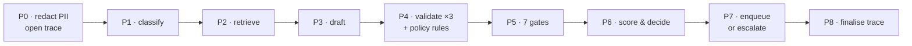
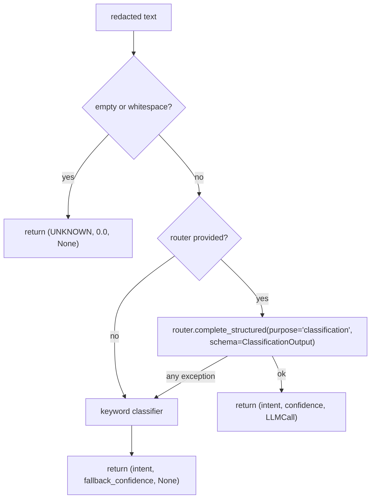
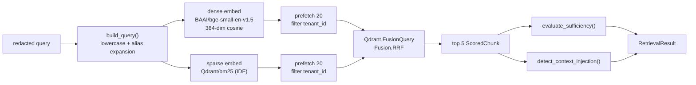
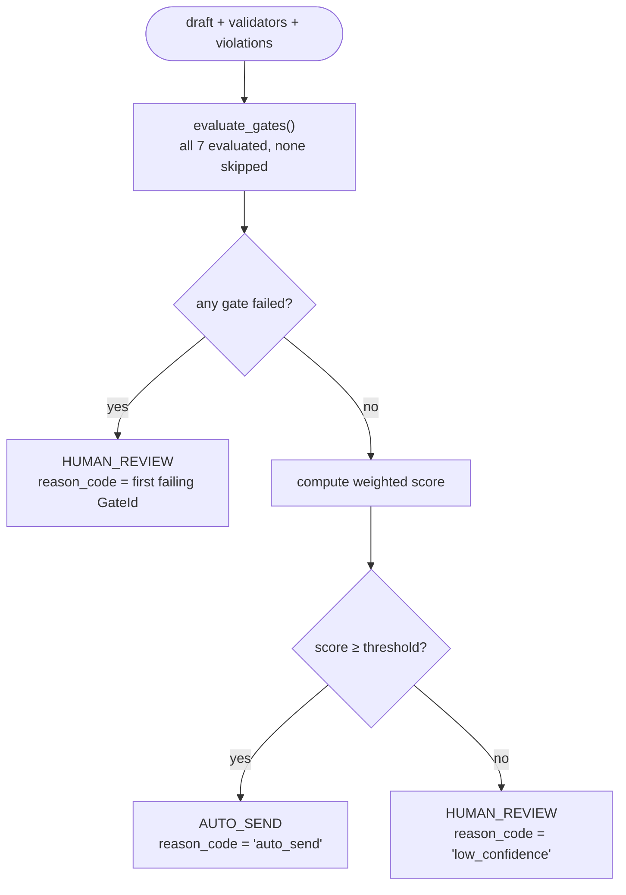
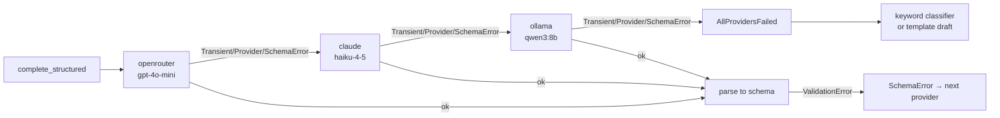
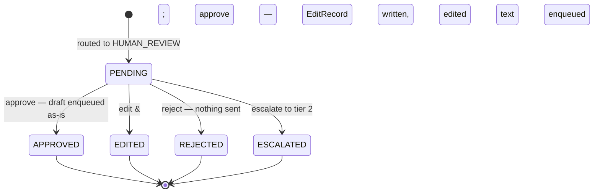
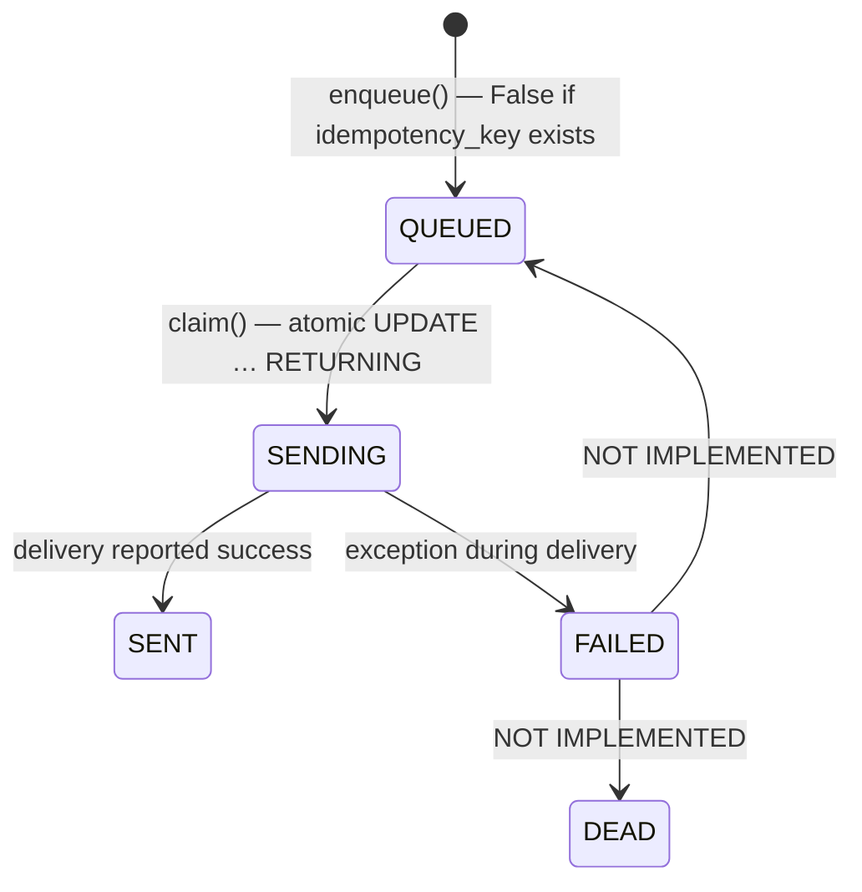

# Product Specification Document (PSD)
# TaskFlow AI Support Agent

| | |
|---|---|
| **Document Version** | 2.0 |
| **Date** | 2026-08-24 |
| **Author** | Vansh Rautela |
| **Supersedes** | PSD v1.0 (2026-08-24) |
| **Companion** | [`BRD.md`](BRD.md) — business requirements |

Every section below carries a *Traces to* line naming the FR/NFR IDs it implements.

```
Status:        v1 implemented — core pipeline complete, delivery/SLA hardening in progress
Last verified: 2026-08-24 via the commands below
Build health:  lint ✗ (24 ruff findings) · types ✗ (9 mypy errors in 5 files)
               · import-boundaries ✓ (1 contract kept, 0 broken) · tests ✓ (68/68 passing)
Verified by:   `uv run pytest -q` (68 passed in 38.32s)
               `uv run lint-imports` (102 files, 222 dependencies analysed)
               `uv run ruff check .` · `uv run mypy src/` · `uv run alembic heads` (d300852af25a)
Runtime:       Python 3.12.13
```

Test layers: unit (64 / 12 files), pipeline (2), integration (2) — all green.
`tests/e2e/` exists and is **empty**; end-to-end scenario tests are in progress. Lint and
type findings are confined to `adapters/channels/`, `api/app.py`, `dashboard/app.py`, the
migration scripts, and one line in `domain/models.py`. The `services/confidence/` package —
the safety core — is clean under both tools.

---

## 1. Product Overview

### 1.1 Product vision

TaskFlow turns an inbound customer message into either a policy-compliant, citation-backed
reply sent automatically, or an escalation to a human with a single explicit reason. The
product is the *decision*, not the prose: any reasonably modern LLM can write the reply,
and almost none can tell you, months later, precisely why sending it was allowed.

The system is built so that the answer to "why did this send?" is always a short,
reconstructable chain — these chunks were retrieved with these scores, this draft cited
them, these three validators returned these results, these seven gates passed, these five
weighted signals produced this score against this threshold, using this model at this cost.

### 1.2 What it does, in order

Ingest → redact PII → classify intent → retrieve context → draft with citations →
validate (×3, concurrent, fail-closed) → evaluate policy rules → evaluate 7 gates →
compute the weighted score → decide → enqueue to outbox **or** create a review item and
alert → finalise the trace.

There are no hidden event buses and no orchestration framework. The whole path is one
readable async function of about 220 lines (ADR-005).

### 1.3 What it is not

It is not multi-tenant in operation (one tenant, `taskflow-demo`), not containerised, not
multilingual, and not load-tested. Those are recorded deferrals with stated triggers, not
oversights — see [BRD §5.3](BRD.md#53-deferred--the-v2-roadmap).

---

## 2. Architecture

*Traces to: NFR-4.1, NFR-4.2, NFR-4.3, NFR-5.1*

### 2.1 Layers

TaskFlow is a hexagonal (ports-and-adapters) application. The layering is not a diagram in
a document — it is a contract checked by CI.

```
┌───────────────────────────────────────────────────────────────────────┐
│  External systems                                                     │
│  OpenRouter · Anthropic · Ollama · Qdrant · SQLite · Gmail · Telegram  │
├───────────────────────────────────────────────────────────────────────┤
│  Adapters — the only layer allowed to know a vendor exists            │
│  adapters/llm/ · adapters/vector/ · adapters/db/ · adapters/channels/  │
├───────────────────────────────────────────────────────────────────────┤
│  Ports — Protocol definitions, no implementations                     │
│  LLMProvider · LLMRouter · VectorStore · *Repository · ChannelConnector│
├───────────────────────────────────────────────────────────────────────┤
│  Services — pure logic, no I/O beyond an injected port                │
│  classify · retrieve · draft · validate · confidence · policy ·        │
│  review · alert · preprocess · cost                                    │
├───────────────────────────────────────────────────────────────────────┤
│  Domain — Pydantic models, enums, errors. Zero I/O, zero dependencies │
└───────────────────────────────────────────────────────────────────────┘
```

`pipeline/orchestrator.py` sits above services and is the one place allowed to wire
adapters to services, via an explicit `Deps` container.

### 2.2 The enforced boundary

`pyproject.toml` declares a single forbidden-import contract:

```toml
[[tool.importlinter.contracts]]
name = "domain and services never touch adapters or SDKs"
type = "forbidden"
source_modules = ["taskflow.domain", "taskflow.services"]
forbidden_modules = [
    "taskflow.adapters", "taskflow.api", "taskflow.worker", "taskflow.dashboard",
    "anthropic", "ollama", "qdrant_client", "googleapiclient", "sqlalchemy", "streamlit",
]
```

`uv run lint-imports` analyses 102 files and 222 dependencies and currently reports
**1 contract kept, 0 broken**. This is what makes "SQLite → PostgreSQL is a config change"
a checked statement rather than a claim: no service can name a SQLAlchemy type, so no
service can depend on SQLite semantics.

> **Known boundary gap.** `src/taskflow/ports/vector_store.py` imports `DocumentChunk`
> from `taskflow.services.retrieve.chunking`, i.e. ports depends on services. The contract
> as written does not forbid it. Moving `DocumentChunk` into `domain/` would close the gap.
> <!-- reconciled: draft implied a clean boundary; the contract is clean but this ports→services edge exists -->

### 2.3 Runtime processes

Four independent processes; none requires a container.

| Process | Entry point | Port | Responsibility |
|---|---|---|---|
| **API server** | `uv run uvicorn taskflow.api.app:app --port 8000` | `:8000` | Message ingestion, trace queries, review actions, metrics |
| **Operator console** | `uv run streamlit run dashboard/app.py` | `:8501` | Human review, trace explorer, KPI panel |
| **Outbox worker** | `uv run python scripts/start_worker.py` | — | Claims queued replies and delivers over SMTP |
| **Gmail poller** | `uv run python scripts/start_gmail_poller.py` | — | Polls IMAP for unseen mail and runs the pipeline |

External processes: **Ollama** on `localhost:11434` (only for the local fallback).
Qdrant and SQLite are **embedded, in-process** — there is no database server and no vector
server (ADR-006, ADR-007).

---

## 3. Pipeline Orchestrator

*Traces to: FR-1.1, FR-8.4, FR-9.1, FR-10.1, FR-12.1*
**File:** `src/taskflow/pipeline/orchestrator.py` (218 lines)

### 3.1 Stage map



### 3.2 Stage contract

| Stage | Input | Output | Module | Failure behaviour |
|---|---|---|---|---|
| **P0** | `InboundMessage` | Redacted copy + new `Trace` | `services/preprocess/service.py` | Pure regex; cannot fail |
| **P1** | Redacted body | `(Intent, confidence, LLMCall \| None)` | `services/classify/service.py` | Any exception → deterministic keyword classifier |
| **P2** | Redacted body + `tenant_id` | `RetrievalResult` | `services/retrieve/service.py` | Empty chunk list → `sufficient=False`; gates and score absorb it |
| **P3** | Message + intent + retrieval | `(DraftOutput, LLMCall \| None)` | `services/draft/service.py` | Any exception → safe template draft |
| **P4** | Draft + retrieval | `list[ValidatorResult]` (3) + `list[PolicyViolation]` | `services/validate/runner.py`, `services/policy/service.py` | Crash or timeout → `errored=True, blocking=True` |
| **P5** | Intent, confidence, validators, violations, injection flag | `list[GateResult]` (7) | `services/confidence/gates.py` | Deterministic; cannot fail |
| **P6** | Gates + 5 signals + weights + threshold | `ConfidenceBreakdown` → `RoutingDecision` | `services/confidence/scorer.py` | Any gate failure wins over any score |
| **P7** | Decision | Outbox row **or** review row + alert | `ports/repositories.py` implementations | Alert dispatch is exception-wrapped and never affects routing |
| **P8** | Final state | Persisted trace | `SQLiteTraceRepository.update` + `.finish` | Runs regardless of the decision |

Every stage is wrapped by `_time_stage`, which records elapsed milliseconds as a
`TraceEventRow`. (Event payloads are currently written as `{}` — the timing is real, the
per-stage payload detail is a stated to-do in the source.)

### 3.3 Dependency injection

```python
@dataclass
class Deps:
    trace_repo: TraceRepository          # Protocol
    llm_router: ProviderRouter
    vector_store: VectorStore | None = None
    review_repo: ReviewRepository | None = None
    outbox_repo: OutboxRepository | None = None

async def run_pipeline(msg: InboundMessage, deps: Deps) -> RoutingDecision: ...
```

Because every field but the router is a Protocol, the entire pipeline runs in tests against
in-memory SQLite and fake providers with no network and no disk service — which is exactly
what `tests/pipeline/test_orchestrator.py` does.

### 3.4 Known behaviour to be aware of

<!-- reconciled: draft described per-intent thresholds as applied; the orchestrator applies only `general` -->
- The threshold passed to `compute()` is `thresholds_config()["thresholds"]["general"]`
  (0.70) **for every intent**. The seven other per-intent thresholds in
  `config/thresholds.yaml` are not yet selected on. See BRD R-3.
- The SLA deadline on a new review item is `now + timedelta(hours=4)`, not derived from
  `sla_minutes`. See BRD R-4.
- `generate_draft` is called with `msg`, and the drafting prompt interpolates
  `msg.body_text` — the **unredacted** body. Classification correctly uses the redacted
  text. See BRD R-1.
- `tone_alignment` is passed as a constant `1.0`; there is no tone scorer yet, so that
  0.10 weight is currently a fixed contribution.

---

## 4. System Components

### 4.1 Preprocessing / PII redaction

*Traces to: FR-2.1 – FR-2.5, NFR-3.1*
**File:** `src/taskflow/services/preprocess/service.py`

```python
def preprocess_message_text(text: str) -> str
```

| Class | Pattern | Replacement |
|---|---|---|
| Card numbers | `\b(?:\d[ -]*?){13,16}\b` | `[REDACTED_CREDIT_CARD]` |
| US SSN | `\b\d{3}-\d{2}-\d{4}\b` | `[REDACTED_SSN]` |
| Secrets / bearer tokens | `\b(?:sk\|pk)_[a-zA-Z0-9_\-]{16,}\b` or `Bearer\s+[a-zA-Z0-9._\-]{20,}` | `[REDACTED_API_KEY]` |

**Dependencies:** none (stdlib `re` only).
**Failure modes:** none — deterministic and total. Deliberate limitation: regex, not NER,
so names, addresses, and phone numbers are not redacted. That is a stated v1 simplification.

### 4.2 Intent classification

*Traces to: FR-3.1 – FR-3.6*
**File:** `src/taskflow/services/classify/service.py`

```python
async def classify_intent(
    text: str, router: LLMRouter | None = None
) -> tuple[Intent, float, LLMCall | None]
```

It is **not** a trained model. It is LLM structured output with a deterministic keyword
fallback. `src/taskflow/ml/` is an empty package; `scikit-learn` and `joblib` are declared
in `pyproject.toml` but unused.
<!-- reconciled: docs/00 described a "trained classifier"; none exists -->

**Intent taxonomy — 8 values from `domain/enums.py`:**

| Intent | Meaning | Auto-send eligible | Configured threshold |
|---|---|---|---|
| `billing` | Charges, invoices, payment methods, double billing | ✅ | 0.80 |
| `technical` | API errors, 5xx, bugs, outages | ✅ | 0.70 |
| `account` | Password resets, 2FA, login | ✅ | 0.70 |
| `feature_request` | New functionality, enhancements | ✅ | 0.75 |
| `refund` | Money back, reimbursement, proration | ✅ | 0.90 |
| `general` | Office hours, general inquiries | ✅ | 0.70 |
| `complaint` | Angry escalation, service-quality grievance | ❌ preempt | 1.01 (unreachable) |
| `unknown` | Ambiguous, unclassifiable, gibberish | ❌ preempt | 1.01 (unreachable) |

`PREEMPT_INTENTS = frozenset({COMPLAINT, UNKNOWN})` is what Gate G4 reads. The 1.01
thresholds are belt-and-braces: even without G4, the score can never reach them.

> **Only the `general` threshold (0.70) is applied by the pipeline today** — see §3.4.
> The table above is the configured intent, not current behaviour.

**Flow:**



**Keyword fallback** (confidences from `thresholds.yaml::fallback_confidences`):

| Trigger keywords | Intent | Confidence |
|---|---|---|
| refund, money back, reimbursement | `refund` | 0.95 |
| bill, invoice, charge, charged | `billing` | 0.90 |
| api, error, 500, 504, bug, crash, webhook, timing out, sso, saml, okta, soc2, nda | `technical` | 0.85 |
| cancel, close account, erase my data | `refund` | 0.90 |
| login, password, 2fa, account | `account` | 0.88 |
| terrible, worst, complain, complaint, ruined | `complaint` | 0.98 |
| *(no match)* | `unknown` | 0.40 |

Note that `unknown` at 0.40 sits below the 0.55 abstain threshold, so an unmatched message
fails Gate G5 *and* Gate G4 — two independent reasons never to auto-send it.

**Failure modes:** the `except Exception` around the router is broad by design (it must
also absorb the `KeyError` described in §7.3). The cost is that a genuine bug in the
classification path is indistinguishable from a provider outage in the trace.

### 4.3 Knowledge retrieval

*Traces to: FR-4.1 – FR-4.8*
**Files:** `services/retrieve/{service,query_builder,sufficiency,injection,chunking}.py`,
`adapters/vector/qdrant_store.py`

```python
async def retrieve_context(
    query: str, tenant_id: str, vector_store: VectorStore | None = None
) -> RetrievalResult
```



**Embedding models** — both run in-process via FastEmbed; no embedding API call is ever
made:

| Model | Type | Dimensions | Role |
|---|---|---|---|
| `BAAI/bge-small-en-v1.5` | dense, cosine | 384 | Semantic match |
| `Qdrant/bm25` | sparse, IDF modifier | variable | Lexical / keyword match |

**Query expansion** (`config/settings.yaml::retrieval.alias_expansions`) — when an alias
appears as a whole word, its expansion is appended in parentheses:

| Alias | Expansion |
|---|---|
| `2fa` | two-factor authentication |
| `sso` | single sign-on |
| `api key` | api token credential |
| `invoice` | billing statement invoice |

**Sufficiency** (`config/thresholds.yaml::retrieval`) returns
`(sufficient, gap_reason, top_score, support_count)`:

| Parameter | Value | Meaning |
|---|---|---|
| `min_top_score` | 0.35 | The best chunk must clear this |
| `min_support_score` | 0.20 | What counts as a supporting chunk |
| `min_support_count` | 2 | How many supporting chunks are required |
| `prefetch_k` | 20 | Candidates per branch before fusion |
| `rerank_k` | 5 | Chunks handed to drafting |

Gap reasons are explicit strings — `no_chunks_retrieved`,
`top_score_too_low (0.281 < 0.350)`, `insufficient_support_count (1 < 2)` — and land on
the trace.

> **Implementation note.** `retrieve_context` calls `vector_store.search(..., limit=5)`
> and `qdrant_store.search` hardcodes `limit=20` on each prefetch branch. The values match
> `rerank_k` and `prefetch_k`, but they are literals in code rather than reads from config.
> There is **no reranker**: `ScoredChunk.rerank_score` exists and is always `None`, so
> `final_score` falls through to `rrf_score`.
> <!-- reconciled: draft implied a rerank stage; none exists -->

**Injection detection** (`services/retrieve/injection.py`) — five case-insensitive patterns
scanned across every retrieved chunk. A single hit sets
`RetrievalResult.suspicious_context=True`, which Gate G7 reads:

```
ignore (all )?(previous|prior) (instructions|rules|prompts)
system prompt:
you are now an?
override (safety|guardrails|filters|policies)
[system_instruction]
```

**Chunking** (`services/retrieve/chunking.py`) — heading-aware markdown splitting at `##`
and deeper, target 450 tokens (~338 words) with 60-token (~45-word) overlap, forced split
if a section runs long. Chunk IDs are `{doc_id}:{ordinal}` where
`doc_id = sha256(f"{relpath}\n{title}")[:16]`, which makes re-ingestion idempotent.

**Failure modes:** an unreachable vector store raises `RetrievalUnavailable`; an empty
result yields `sufficient=False`, which zeroes the 0.20 retrieval-relevance signal and
usually escalates on score.

### 4.4 Response drafting

*Traces to: FR-5.1 – FR-5.7*
**File:** `src/taskflow/services/draft/service.py`

```python
async def generate_draft(
    msg: InboundMessage, intent: Intent,
    retrieval: RetrievalResult, router: LLMRouter,
) -> tuple[DraftOutput, LLMCall | None]
```

Retrieved chunks are formatted into the prompt as labelled blocks:

```
[Chunk ID: {chunk_id} | Title: {title} | Section: {section}]
{text}
```

The system prompt requires the model to answer exclusively from those blocks, to cite
inline as `[chunk_id]`, to pick a tone from the five allowed strings, and never to invent
dates or terms.

**The `DraftOutput` contract** (`domain/models.py`) — validated, never trusted:

| Field | Type | Constraint |
|---|---|---|
| `response_text` | `str` | 1–4000 chars; accepts aliases `response`, `reply`, `body` |
| `citations` | `list[Citation]` | Bare strings are coerced to `Citation` objects |
| `tone` | `str` | `^(formal\|friendly\|apologetic\|neutral\|technical)$` |
| `complexity` | `str` | `^(simple\|moderate\|complex)$` |
| `draft_confidence` | `float` | 0.0–1.0, default 0.85 — **logged only, never routed on** |

`model_config` is `extra="ignore"` so a chatty model's surplus keys do not fail the parse.

**Citation enforcement** — a model validator runs at parse time:

```python
@model_validator(mode="after")
def _citation_markers_present(self) -> Self:
    if self.citations:
        missing = [c.chunk_id for c in self.citations
                   if f"[{c.chunk_id}]" not in self.response_text]
        if missing:
            valid = [c for c in self.citations if f"[{c.chunk_id}]" in self.response_text]
            object.__setattr__(self, "citations", valid)
    return self
```

<!-- reconciled: draft claimed this raises ValueError; it strips instead -->
It **strips** citations that are not referenced inline rather than raising. The rationale is
that a local model that lists a citation without using it should be corrected, not have its
whole response discarded. The strictness is recovered downstream: the `citations` validator
independently checks every remaining structured citation *and* every inline `[id]` marker
against the actually-retrieved chunk IDs, and Gate G3 vetoes on failure.

**Template fallback** — when the router raises for any reason:

```
Thank you for reaching out regarding your {intent} request. [{first_chunk_id}]
Our support team has logged this request.
```

with `tone="friendly"`, `complexity="simple"`, and
`draft_confidence = fallback_confidences.draft` (0.50). Because it carries essentially no
grounded content, its grounding ratio collapses and it escalates on score.

### 4.5 Validation

*Traces to: FR-6.1 – FR-6.6, NFR-2.4*
**Files:** `services/validate/{runner,pii_leak,citations,grounding}.py`

```python
async def run_validators(
    draft: DraftOutput, retrieval: RetrievalResult | None, timeout_s: float = 15.0
) -> Sequence[ValidatorResult]
```

**Three validators, run concurrently under `asyncio.gather`:**

| # | Name | File | What it computes | Blocking | Gate |
|---|---|---|---|---|---|
| 1 | `pii_leak` | `pii_leak.py` | Scans the **outbound draft** for the same three secret classes as inbound redaction | yes on failure | G2 |
| 2 | `citations` | `citations.py` | Union of structured citation IDs and inline `[id]` markers must all resolve to retrieved chunk IDs; score = resolved fraction | yes on failure | G3 |
| 3 | `grounding` | `grounding.py` | Word-overlap ratio against the concatenated context; compared to `min_grounding_ratio` (0.80) | **no** | none — feeds the score only |

<!-- reconciled: ADR-003 and docs/00 say "five validators"; three exist -->
<!-- reconciled: ADR-003 says grounding uses an LLM; it is word overlap -->

**What grounding actually computes:**

```python
context   = " ".join(chunk.text.lower() for chunk in retrieval.chunks)
meaningful = {w for w in draft.response_text.lower().split() if len(w) > 3}
grounded   = {w for w in meaningful if w in context}
ratio      = round(len(grounded) / len(meaningful), 2)
```

This is a **word-overlap proxy, not entailment.** It has honest limitations: substring
matching means "bill" matches inside "billing"; word order and negation are invisible; a
draft that copies context verbatim scores 1.0 regardless of whether it answers the
question. It is cheap, deterministic, explainable, and adds no LLM call — the trade
recorded in ADR-003, revised here because the ADR describes an LLM entailment check that
was not built. A cross-encoder or NLI entailment upgrade is the natural v2 move.

Note also that grounding is **non-blocking** and has no gate. A poorly grounded draft is
punished through the 0.25 weight, not vetoed — a deliberate choice, since a low overlap
ratio is evidence, not proof.

**The fail-closed doctrine** (`runner.py::safe_run`):

```python
try:
    return await asyncio.wait_for(coro, timeout=timeout_s)
except TimeoutError:
    return ValidatorResult(validator_name=name, passed=False, score=0.0,
                           reason="Validator timed out", blocking=True, errored=True)
except Exception as e:
    return ValidatorResult(validator_name=name, passed=False, score=0.0,
                           reason=f"Validator crashed: {e}", blocking=True, errored=True)
```

`errored=True` is what Gate G6 reads. A validator that breaks is treated as a validator
that failed — never as a validator that was skipped.

### 4.6 Policy engine

*Traces to: FR-13.1 – FR-13.5*
**Files:** `services/policy/service.py`, `config/policies.yaml`

```python
def evaluate_policies(
    msg: InboundMessage, draft: DraftOutput | None, intent: Intent
) -> list[PolicyViolation]
```

Ten rules, entirely data-driven — adding a rule is a YAML edit, never a code change
(ADR-004). Each rule declares an `id`, a `severity`, an optional `applies_to`
(`inbound` | `outbound`, default `outbound`), an optional `applies_when.intent` filter, and
a `detect` block.

**Four detection types are implemented:**

| Type | Semantics |
|---|---|
| `amount_over` | Extract dollar amounts by regex; violate if any exceeds `threshold` |
| `regex_any` | Violate on the first pattern that matches the target text |
| `regex_absent` | Violate when **none** of the patterns match — used for required language |
| `price_mismatch` | If a plan name appears in the draft, any quoted dollar figure that differs from the known price violates |

**Critical rules — these block auto-send via Gate G1:**

| Rule ID | Applies to | Detection | Rationale |
|---|---|---|---|
| `refund_ceiling` | outbound | `amount_over`, threshold **500** | Support has no authority to approve above the ceiling |
| `no_feature_dates` | outbound | `regex_any` — "will be available in/by", "next quarter we will ship" | Never commit a ship date for an unreleased feature |
| `no_credential_request` | outbound | `regex_any` — "send/share/provide/confirm your password / 2FA / OTP / API key" | Support must never ask for a secret |
| `legal_threat_escalation` | **inbound** | `regex_any` — lawyer, attorney, legal action, sue, lawsuit, small claims, GDPR complaint | A legal threat is always a human's problem |
| `gdpr_deletion_routing` | **inbound** | `regex_any` — "delete/erase/remove (all) my/our data/account/personal data" | Deletion requests belong to the privacy team |
| `no_discount_invention` | outbound | `regex_any` — "NN% off/discount", "free month/year/upgrade" | Only discounts defined in the KB may be offered |
| `no_security_details` | outbound | `regex_any` — "our/the database/infrastructure runs/uses", "internal endpoint/service/hostname" | No internal architecture disclosure |

**Warning rules — recorded on the trace, never blocking:**

| Rule ID | Applies when | Detection |
|---|---|---|
| `pricing_accuracy` | outbound | `price_mismatch` against `{pro: 12, enterprise: 29}` |
| `no_competitor_disparagement` | outbound | `regex_any` — "worse/inferior/broken than" |
| `escalation_language_required` | intent ∈ {`complaint`, `refund`} | `regex_absent` — the draft must contain "I'm sorry", "I apologise", or "understand your frustration" |

<!-- reconciled: draft claimed warning violations reduce the tone score; tone_alignment is a constant 1.0 -->
> Warnings currently have **no numeric effect**. The v1 draft stated they reduce the tone
> score; `tone_alignment` is passed as a constant `1.0`, so they do not. Wiring warnings
> into a real tone signal is the intended fix.

**Failure modes:** a rule with an invalid regex raises at evaluation time and would
propagate out of the pipeline — there is no per-rule exception isolation. Adding one is a
small, worthwhile hardening.

### 4.7 The two-layer confidence architecture

*Traces to: FR-7.1 – FR-7.9, FR-8.1 – FR-8.5, BO-1, BO-2*
**Files:** `services/confidence/gates.py`, `services/confidence/scorer.py` · **ADR-001**

This is the centrepiece of the product.

#### 4.7.1 Why two layers

The rejected design put `policy_compliance` at weight 0.15 inside a weighted average with
a 0.80 auto-send bar. A draft with a critical policy violation scoring 0.0 on that term and
1.0 everywhere else reaches **0.85 and auto-sends.** The PII validator had no term at all,
so it could fail and change nothing. That is not a safety system; it is a safety-flavoured
average.

The fix is categorical rather than numerical: **safety is a veto, not a weight.** Gates are
evaluated first and are conjunctive. The score is computed only to choose among drafts that
already passed every gate.

#### 4.7.2 Layer 1 — seven conjunctive veto gates

```python
def evaluate_gates(
    intent: Intent, intent_confidence: float, abstain_threshold: float,
    validators: list[ValidatorResult], violations: list[PolicyViolation],
    citations_resolve: bool, suspicious_context: bool,
) -> list[GateResult]
```

Note the signature: `evaluate_gates` is a **pure function**. No I/O, no config lookup, no
clock. Everything it needs is passed in, which is why the six gate tests run in
milliseconds with no fixtures.

| Gate | `GateId` value | Passes when | Trips on |
|---|---|---|---|
| **G1** | `G1_policy_critical` | no violation has `severity == CRITICAL` | $600 refund promise, ship-date commitment, credential request, legal threat, GDPR deletion, invented discount, infrastructure disclosure |
| **G2** | `G2_pii_leak` | the `pii_leak` validator passed | card number, SSN, or secret key in the outbound draft |
| **G3** | `G3_citations_resolve` | `citations_resolve` is `True` | a `[chunk_id]` marker or structured citation that resolves to nothing retrieved |
| **G4** | `G4_intent_allows_auto` | `intent not in PREEMPT_INTENTS` | intent is `complaint` or `unknown` |
| **G5** | `G5_classifier_confident` | `intent_confidence >= abstain_threshold` (0.55) | the classifier is not sure enough to act autonomously |
| **G6** | `G6_validators_healthy` | no validator has `errored=True` | a validator crashed or exceeded 15 s |
| **G7** | `G7_no_suspicious_context` | `suspicious_context` is `False` | instruction-like text inside a retrieved chunk |

All seven are evaluated every time — the function does not short-circuit — so the trace
records the state of every gate, not just the first failure. `decide()` then reports the
**first** failed gate as the reason code, which is why every escalation has exactly one
cause.



#### 4.7.3 Layer 2 — the weighted quality score

```python
def compute(gates, signals, weights, threshold, draft_confidence) -> ConfidenceBreakdown
def decide(breakdown) -> RoutingDecision
```

| Signal | Weight | How the orchestrator computes it |
|---|---|---|
| `citation_coverage` | **0.35** | `1.0` if the `citations` validator passed, else `0.0` |
| `grounding_entailment` | **0.25** | The grounding validator's word-overlap ratio (continuous) |
| `retrieval_relevance` | **0.20** | `1.0` if `RetrievalResult.sufficient`, else `0.0` |
| `intent_confidence` | **0.10** | The classifier's confidence (continuous) |
| `tone_alignment` | **0.10** | Constant `1.0` — no tone scorer exists yet |
| | **1.00** | Sum verified: 0.35 + 0.25 + 0.20 + 0.10 + 0.10 = 1.00 ✓ |

`score = Σ signalᵢ × weightᵢ`, then:

```
if breakdown.failed_gates:            → HUMAN_REVIEW, reason_code = first failed gate ID
elif breakdown.score >= threshold:    → AUTO_SEND,    reason_code = "auto_send"
else:                                 → HUMAN_REVIEW, reason_code = "low_confidence"
```

`compute()` deliberately calculates the score **even when gates have failed**, so the trace
answers "how good was this draft, independently of why we refused to send it?" — which is
exactly what makes `test_critical_policy_violation_never_auto_sends` legible: the score is
above 0.95 *and* the message is escalated.

`draft_confidence` — the model's own opinion of its work — is carried into
`ConfidenceBreakdown.draft_confidence_logged` and read by nothing in `decide()`. A model's
self-assessment is evidence for a human, never an input to an autonomous decision.

> **Calibration note.** Three of the five signals are currently binary or constant
> (`citation_coverage`, `retrieval_relevance`, `tone_alignment`). A draft that passes
> citations, retrieves sufficiently, and has any tone therefore starts at a floor of
> 0.35 + 0.20 + 0.10 = **0.65**, only 0.05 below the 0.70 threshold actually in use. This
> makes the effective bar softer than the configuration implies, and is a second reason to
> land the per-intent threshold fix (BRD R-3) alongside a continuous tone signal.

### 4.8 LLM provider system

*Traces to: NFR-2.1, NFR-2.2, NFR-2.6, FR-12.2*
**Files:** `adapters/llm/{router,openrouter,claude,ollama}.py`, `config/providers.yaml`

```python
class ProviderRouter(LLMRouter):
    async def complete_structured[T: BaseModel](
        self, *, purpose: str, system: str, user: str, schema: type[T]
    ) -> tuple[T, LLMCall]
```

**Configured providers** (`config/providers.yaml` — the only place model IDs are allowed
to appear, enforced by `scripts/check_no_hardcoded_models.py` and a pre-commit hook):

| Provider | Auth env var | Models by purpose | Timeout | Pricing per 1K tokens |
|---|---|---|---|---|
| **openrouter** | `OPENROUTER_API_KEY` | `classification`, `draft`, `grounding`, `datagen` → `openai/gpt-4o-mini` | 30 s | in $0.00015 / out $0.0006 |
| **claude** | `ANTHROPIC_API_KEY` | `draft`, `grounding` → `claude-haiku-4-5`; `datagen` → `claude-sonnet-4-5` | 30 s | **in $0.0 / out $0.0 — placeholder** |
| **ollama** | `OLLAMA_BASE_URL` | `draft`, `grounding`, `datagen` → `qwen3:8b` | 120 s | free (local) |

<!-- reconciled: draft said Ollama runs qwen2.5:7b-instruct; providers.yaml says qwen3:8b -->
<!-- reconciled: draft said Claude pricing "configurable"; it is an unfilled 0.0/0.0 placeholder -->

> **Claude pricing is unset.** `config/providers.yaml` carries `{in_per_1k: 0.0,
> out_per_1k: 0.0}` with a comment to fill it from the pricing page. Every Claude call
> therefore records `cost_usd = 0.0`, so the ledger understates spend whenever failover
> reaches Claude. Verify current prices at <https://claude.com/pricing#api> before quoting
> a figure.

**Operating modes** (`priority` in `providers.yaml`, selected by `TASKFLOW_LLM_MODE`):

| Mode | Chain | Use |
|---|---|---|
| `cloud_first` | openrouter → claude → ollama | Normal operation |
| `local_only` | ollama | Zero-network operation; demo insurance |



**Structured output per provider:**

- **OpenRouter** — the JSON schema is appended to the system prompt and
  `response_format: {"type": "json_object"}` is set; the raw text is then parsed against
  the Pydantic model.
- **Claude** — native `messages.parse(output_format=schema)` with constrained decoding;
  `stop_reason` of `refusal` or `max_tokens` is raised as `SchemaError` so the router moves
  on.
- **Ollama** — the JSON schema is passed as `format=`, which the runtime compiles to a GBNF
  grammar; if that fails, it degrades to `format="json"`, so the local fallback keeps a
  structural guarantee.

**Every adapter translates its vendor exception into a domain error** (`TransientError`,
`ProviderError`, `SchemaError`). This is what lets `services/` handle failure without ever
importing `anthropic` or `ollama`.

**Cost accounting** — `services/cost/service.py::calculate_cost` reads pricing from
`providers.yaml` and computes `(prompt/1000)·in_rate + (completion/1000)·out_rate`, rounded
to 6 decimals, recorded per call on the `LLMCall` model.

> **Known gap (BRD R-8): classification cannot fail over.** Only `openrouter` defines a
> `classification` model. When the router reaches Claude for that purpose,
> `model_for("claude", "classification")` raises `KeyError`, which is **not** in the
> router's `except (TransientError, ProviderError, SchemaError)` clause, so it escapes
> `complete_structured` entirely. `classify_intent`'s broad `except Exception` catches it
> and falls back to keywords. Net effect: the classification chain is *OpenRouter, or
> keywords* — the drafting chain is the only genuinely 3-deep one.
> <!-- reconciled: draft described a 3-deep failover for all purposes -->

**Budgets** — `providers.yaml` declares `max_llm_calls_per_message: 3`,
`daily_spend_usd: 2.00`, `alert_at_pct: 80`. **No code reads this block.** The natural
ceiling is 2 calls per message (one classification, one draft) because grounding is
deterministic. Enforcement is a v2 item.

### 4.9 Human review console

*Traces to: FR-9.1 – FR-9.6*
**Files:** `services/review/service.py`, `dashboard/app.py`

```python
async def list_pending_reviews(repo)                                  -> list[ReviewItem]
async def get_review_detail(repo, review_id)                          -> ReviewItem | None
async def approve_review(review_repo, outbox_repo, review_id, ...)    -> bool
async def edit_and_approve_review(review_repo, outbox_repo, review_id,
                                  edited_text, ...)                   -> bool
async def reject_review(review_repo, review_id, ...)                  -> bool
async def escalate_review(review_repo, review_id, ...)                -> bool
```

**State machine:**



Every transition goes through one optimistic-locking UPDATE:

```sql
UPDATE reviews SET state = :to WHERE review_id = :id AND state = :expected
-- rowcount == 1 → this actor won; 0 → someone else got there first
```

Two operators clicking Approve on the same item at the same moment produce exactly one
send. `tests/unit/test_review_worker.py::test_optimistic_lock_collision` is the proof.

**Operator console — three Streamlit tabs** (`dashboard/app.py`):

| Tab | Contents |
|---|---|
| 📝 **Human Review Console** | The pending queue; per item, the inbound customer query, the routing and safety analysis (action, reason, reason code, score vs threshold), the citations and KB chunks, an editable draft, an operator-notes field, and Approve / Edit&Approve / Reject / Escalate |
| 🔍 **Traces & Observability** | Trace table and a detail inspector for a chosen `trace_id` |
| 📊 **System Health & Metrics** | Total messages, auto-send rate, human-review rate, total LLM cost, intent breakdown |

**Recipient addressing:** `ReviewItem.sender_email` and `ReviewItem.inbound_body` were
added by migrations `019f6dc5d4f0` and `d300852af25a` so the operator sees the original
message and the approved reply reaches the right person. The fallback address when
`sender_email` is null is `support-fallback@taskflow.dev`.

**Failure modes:** `approve_review` returns `False` when the item is missing or no longer
`PENDING`; the API turns that into `400`. Note that the transition commits *before* the
outbox enqueue, so a crash between the two leaves an APPROVED item with no queued reply —
an at-most-once seam that a single transaction spanning both would close.

### 4.10 Outbound delivery

*Traces to: FR-10.1 – FR-10.5, NFR-2.3*
**Files:** `worker/outbox_worker.py`, `adapters/db/repositories.py::SQLiteOutboxRepository`

```python
async def process_outbox_batch(outbox_repo: OutboxRepository, limit: int = 10) -> int
async def run_worker_loop(outbox_repo, poll_interval_s: float = 1.0,
                          run_once: bool = False) -> int
```



**Claim is a single atomic statement**, so two workers cannot claim the same row:

```sql
UPDATE outbox SET state = 'sending'
WHERE outbound_id IN (SELECT outbound_id FROM outbox WHERE state = 'queued' LIMIT :n)
  AND state = 'queued'
RETURNING *
```

**Idempotency keys** — two forms are in use:

| Origin | Key format |
|---|---|
| Pipeline auto-send | `OutboundMessage.make_idempotency_key(conversation_id, body)` → `{conversation_id}:{sha256(body)[:16]}` |
| Operator approve / edit | `outbound:{review_id}:approved` / `outbound:{review_id}:edited` |

Both are backed by `UNIQUE(idempotency_key)` in the schema, so `enqueue()` returning
`False` is the first line of send-once defence and the constraint is the second.

> **Known gap (BRD R-5).** `deliver_message()` attempts SMTP when the recipient contains
> `@`, but its final statement is an unconditional `return True`. A failed send is
> therefore marked `SENT`. There is also no lease column, no `retry_count` increment, and
> no `DEAD` transition, despite `claim_lease_minutes: 5` and `max_attempts: 3` in
> `config/settings.yaml`. Delivery is currently **at-most-once with optimistic reporting**,
> not the at-least-once-with-retry the config describes.
> <!-- reconciled: draft described retry/lease/DEAD as implemented -->

### 4.11 Alerting

*Traces to: FR-11.1 – FR-11.5, BO-7*
**File:** `services/alert/service.py`

```python
async def send_email_alert(subject, body, recipient=None)   -> bool
async def send_telegram_alert(text, parse_mode="HTML")      -> bool
async def send_custom_webhook_alert(payload: dict)          -> bool
async def dispatch_alert(item: ReviewItem)                  -> dict[str, bool]
```

| Channel | Transport | Configuration | Payload |
|---|---|---|---|
| **Email** | Gmail SMTP, `smtp.gmail.com:587`, STARTTLS | `GMAIL_USER`, `GMAIL_APP_PASSWORD`, `OPS_EMAIL` | Full plain-text brief: review ID, trace ID, tenant, customer address, the query, action/reason/reason-code, score vs threshold, the draft, citations |
| **Telegram** | Bot API `sendMessage` | `TELEGRAM_BOT_TOKEN`, `TELEGRAM_CHAT_ID` | HTML-formatted brief with the same fields, every interpolated value passed through `html.escape` |
| **Webhook** | HTTP POST, 10 s timeout | `ALERT_WEBHOOK_URL` | The complete `ReviewItem` as JSON |

**Independent failure is the design point.** Each sender returns a plain `bool`, catches
its own exceptions, and returns `False` when its credentials are absent — an unconfigured
channel is a silent no-op, not an error. `dispatch_alert` calls all three in sequence and
returns a per-channel result map. The orchestrator additionally wraps the whole dispatch in
`try/except`, so **no alerting failure can change a routing decision.**

> The three channels above are the supported set. The repository also contains one
> additional webhook sender in this module that is **not part of the product**, and a
> `TEAMS_WEBHOOK_URL` setting plus `alerts.channel: teams` in `config/settings.yaml` for
> which no Teams transport exists at all. Neither is documented as a supported channel
> here; both should be removed. See §7.1.
> <!-- reconciled: an extra chat-webhook channel in the v1 draft is excluded by product decision; Teams config is vestigial -->

**Cost of the current design:** alerts are dispatched sequentially and inline with the
request, so three slow channels add their timeouts (up to ~10 s each for Telegram and the
webhook) to the pipeline's tail latency. Moving to `asyncio.gather` would be a one-line
improvement.

### 4.12 Observability

*Traces to: FR-12.1 – FR-12.5, BO-2*
**Files:** `domain/models.py::Trace`, `adapters/db/repositories.py::SQLiteTraceRepository`

The `Trace` is the product's audit artefact. One per message, capturing:

`trace_id` · `conversation_id` · `message_id` · `tenant_id` · `source_channel` ·
`started_at` / `finished_at` · `intent` + `intent_confidence` + `classifier_version` ·
the whole `RetrievalResult` (chunks, scores, sufficiency, gap reason, injection flag) ·
the whole `DraftOutput` · every `ValidatorResult` · the whole `ConfidenceBreakdown`
(all seven gates, all five signals, the weights, the score, the threshold) ·
the `RoutingDecision` · every `LLMCall` · `delivery_result` · `errors`

`Trace.total_cost_usd` sums the call ledger. Complex sub-objects are stored as JSON columns
on `traces`, so a trace round-trips through `_row_to_trace` back into fully typed Pydantic
models — which is why `GET /traces/{id}` can hand a reviewer the complete decision.

---

## 5. REST API Specification

*Traces to: FR-1.1, FR-9.2, FR-12.4, FR-12.5*
**File:** `src/taskflow/api/app.py` · **Base URL:** `http://localhost:8000`

| Method | Path | Request | Success response | Errors |
|---|---|---|---|---|
| `GET` | `/` | — | Service banner: name, status, and an endpoint index | — |
| `GET` | `/healthz` | — | `{"status": "ok", "service": "taskflow-api"}` | — |
| `GET` | `/favicon.ico` | — | `204 No Content` (excluded from the OpenAPI schema) | — |
| `POST` | `/messages` | `InboundMessageRequest` | `{message_id, action, reason, reason_code, score}` | — |
| `GET` | `/traces?limit=50` | query `limit` ∈ [1, 200] | `list[Trace]` (JSON mode) | — |
| `GET` | `/traces/{trace_id}` | — | `Trace` | `404` not found |
| `GET` | `/reviews` | — | `list[ReviewItem]`, pending only, SLA order | — |
| `POST` | `/reviews/{review_id}/approve` | `OperatorRequest` | `{"status": "approved", "review_id": …}` | `400` not found or not pending |
| `POST` | `/reviews/{review_id}/edit` | `EditReviewRequest` | `{"status": "edited_and_approved", "review_id": …}` | `400` as above |
| `POST` | `/reviews/{review_id}/reject` | `OperatorRequest` | `{"status": "rejected", "review_id": …}` | `400` as above |
| `GET` | `/metrics` | — | metrics object (below) | — |

> There is **no** `POST /reviews/{id}/escalate` endpoint, although `escalate_review()`
> exists in the service layer and the Streamlit console uses it directly.
> <!-- reconciled: draft implied escalation was available over REST -->

### 5.1 Request schemas

```python
class InboundMessageRequest(BaseModel):
    message_id: str
    tenant_id:  str = "taskflow-demo"
    channel:    Channel = Channel.CONSOLE     # email | webchat | console
    sender:     str
    subject:    str | None = None
    body_text:  str

class OperatorRequest(BaseModel):
    operator: str = "operator_admin"
    reason:   str | None = None

class EditReviewRequest(BaseModel):
    edited_text: str
    operator:    str = "operator_admin"
    reason:      str = "human edit"
```

### 5.2 Example — ingest

```http
POST /messages
Content-Type: application/json

{
  "message_id": "msg-001",
  "tenant_id":  "taskflow-demo",
  "channel":    "email",
  "sender":     "customer@example.com",
  "subject":    "Refund request",
  "body_text":  "I need a refund for unused seat licenses"
}
```

```json
{
  "message_id":  "msg-001",
  "action":      "human_review",
  "reason":      "Critical policy violation detected",
  "reason_code": "G1_policy_critical",
  "score":       0.913
}
```

`action` is a `RouteAction` value; `reason_code` is either a `GateId` value, `auto_send`,
or `low_confidence`.

### 5.3 Metrics response

```json
{
  "total_traces": 42,
  "actions_breakdown": {"auto_send": 24, "human_review": 18},
  "auto_send_rate_pct": 57.14,
  "human_review_rate_pct": 42.86,
  "total_cost_usd": 0.014712
}
```

Computed over the **200 most recent traces**, not all time.

### 5.4 Lifecycle and known API-layer notes

`lifespan()` builds the engine, runs `Base.metadata.create_all`, constructs the three
repositories, instantiates `ProviderRouter()` and `QdrantVectorStore()`, and stores the
`Deps` container in a module-level dict. On shutdown it disposes the engine.

- The API constructs `dedupe_key` as `f"{tenant_id}:{message_id}"`, which differs from
  `InboundMessage.make_dedupe_key()`'s `{channel}:{provider_message_id}`. Since no dedupe
  check runs in the pipeline, neither form is currently enforced.
  <!-- reconciled: draft described dedupe as an active pipeline stage -->
- `create_all` at startup coexists with Alembic migrations. For a fresh database either is
  sufficient; the migrations are the authority for schema evolution.
- There is no authentication on any endpoint. `TASKFLOW_API_TOKEN` exists in settings and
  is unused. Acceptable for a single-machine demo, and a v2 prerequisite for anything else.

---

## 6. Data Model Specification

*Traces to: FR-1.1, FR-5.1, FR-9.3, FR-10.2, FR-12.1, NFR-5.4*

### 6.1 Domain models

All inherit `Base(BaseModel)` with `model_config = ConfigDict(frozen=True, extra="forbid")`
— immutable, and unknown fields are a parse error. `DraftOutput` is the single exception
(`extra="ignore"`), because an LLM will add keys.

**`InboundMessage`**

| Field | Type | Notes |
|---|---|---|
| `message_id` | `str` | Our UUID |
| `dedupe_key` | `str` | `{channel}:{provider_message_id}` via `make_dedupe_key()` |
| `tenant_id` | `str` | Isolation key present on every table |
| `channel` | `Channel` | `email` \| `webchat` \| `console` |
| `sender` | `str` | Customer address or identifier |
| `subject` | `str \| None` | |
| `body_text` | `str` | Normalised original |
| `body_redacted` | `str` | PII-redacted; intended as the only text an LLM sees |
| `thread_ref` | `str \| None` | Gmail `threadId`; also seeds `conversation_id` |
| `provider_message_id` | `str` | External ID |
| `provider_thread_headers` | `dict[str, str]` | `In-Reply-To`, `References` |
| `received_at` | `datetime` | UTC |
| `raw_ref` | `str \| None` | Archived original |

**`Chunk` / `ScoredChunk` / `RetrievalResult`**

`Chunk`: `chunk_id` (`{doc_id}:{ordinal}`), `doc_id`, `title`, `section`, `text`,
`doc_type`, `product_tier`, `intents`, `version`, `source_path`, `tenant_id`.
`ScoredChunk` adds `dense_score`, `sparse_score`, `rrf_score`, `rerank_score`, and a
`final_score` property preferring `rerank_score` when present (it never is today).
`RetrievalResult`: `query_used`, `chunks`, `sufficient`, `gap_reason`,
`suspicious_context`, `latency_ms`, `top_score`, `support_count`.

**`DraftOutput` / `Citation`** — see §4.4.
**`ValidatorResult`** — `validator_name`, `passed`, `score`, `reason`, `evidence`,
`blocking`, `latency_ms`, `errored`.
**`PolicyViolation`** — `rule_id`, `severity`, `description`, `matched_text`.
**`GateResult`** — `gate_id`, `passed`, `reason`.

**`ConfidenceBreakdown`** — the seven `GateResult`s, the five signal values, the `weights`
dict, `score`, `threshold`, and `draft_confidence_logged`, plus two derived properties:
`failed_gates` and `gates_passed`.

**`RoutingDecision`** — `action`, `reason`, `reason_code`, `confidence`, `decided_at`.

**`ReviewItem`** — `review_id`, `trace_id`, `conversation_id`, `tenant_id`, `state`,
`draft`, `decision`, `created_at`, `sla_deadline`, `escalated_at`, `sender_email`,
`inbound_body`.

**`EditRecord`** — `review_id`, `original_draft`, `edited_draft`, `editor`, `edited_at`,
`reason`, `char_diff`.

**`OutboundMessage`** — `outbound_id`, `conversation_id`, `tenant_id`, `channel`,
`recipient`, `subject`, `body_text`, `reply_headers`, `state`, `idempotency_key`,
`retry_count`, plus `make_idempotency_key()`.

**`LLMCall`** — `purpose`, `provider`, `model`, `prompt_tokens`, `completion_tokens`,
`cost_usd`, `latency_ms`, `attempts`, `repaired`, `failed_over`.

**`Trace` / `TraceEvent`** — see §4.12.

### 6.2 Enumerations (`domain/enums.py`)

| Enum | Values |
|---|---|
| `Channel` | `email`, `webchat`, `console` |
| `Intent` | `billing`, `technical`, `account`, `feature_request`, `refund`, `complaint`, `general`, `unknown` — **8** |
| `RouteAction` | `auto_send`, `human_review`, `template_sent`*, `rejected_spam`*, `dropped_duplicate`* |
| `GateId` | `G1_policy_critical` … `G7_no_suspicious_context` — **7** |
| `ReviewState` | `pending`, `approved`, `edited`, `rejected`, `escalated` |
| `OutboxState` | `queued`, `sending`, `sent`, `failed`, `dead`* |
| `Severity` | `critical`, `warning` |

\* defined but never emitted by current code — see BRD §5.3.

### 6.3 Persistence schema

`src/taskflow/adapters/db/orm.py` — nine tables, every one carrying `tenant_id`.

| Table | Primary business key | Notable columns | Constraints |
|---|---|---|---|
| `inbox` | `dedupe_key` | message, channel, sender, both body forms, thread headers, `raw_ref` | **UNIQUE(dedupe_key)** |
| `traces` | `trace_id` | intent, confidence, `classifier_version`, and JSON columns for retrieval / draft / validators / confidence / decision / llm_calls / errors | UNIQUE(trace_id) |
| `trace_events` | — | `trace_id`, `stage`, `payload`, `elapsed_ms`, `at` | index(trace_id) |
| `reviews` | `review_id` | `state`, `draft_json`, `decision_json`, `sla_deadline`, `escalated_at`, `sender_email`, `inbound_body` | UNIQUE(review_id) |
| `edit_records` | — | original / edited draft, editor, reason, `char_diff` | index(review_id) |
| `outbox` | `outbound_id` | recipient, subject, body, `reply_headers`, `state`, `retry_count`, `last_error` | **UNIQUE(idempotency_key)** (`uq_outbox_idempotency_key`) |
| `llm_calls` | — | provider, model, tokens, cost, latency, attempts, `failed_over` | index(trace_id) |
| `audit` | — | actor, action, entity type/id, payload | index(entity_id) |
| `alerts` | — | alert type, entity, message, channel, `sent`, `error` | index(tenant_id) |

The two UNIQUE constraints marked in bold are the safety-critical ones and are directly
tested (`test_inbox_try_claim_unique`, `test_outbox_no_double_send`).

`llm_calls`, `audit`, and `alerts` are defined and migrated but **not yet written to** —
LLM calls are currently persisted inside `traces.llm_calls_json`.

**Engine configuration** (`adapters/db/engine.py`) — on every pooled connection:
`PRAGMA journal_mode=WAL`, `PRAGMA busy_timeout=5000`, `PRAGMA foreign_keys=ON`.
`verify_engine()` asserts WAL took effect.

**Migrations** — Alembic, 3 revisions, head `d300852af25a`:

| Revision | Change |
|---|---|
| `0001_initial` | All nine tables |
| `019f6dc5d4f0` | `reviews.sender_email` |
| `d300852af25a` | `reviews.inbound_body` |

---

## 7. Configuration Reference

*Traces to: NFR-4.2, ADR-004*

### 7.1 Environment variables (`.env`)

Loaded by `pydantic-settings` in `src/taskflow/config/settings.py` with `extra="ignore"`.

| Variable | Default | Purpose |
|---|---|---|
| `TASKFLOW_ENV` | `local` | Environment label |
| `TASKFLOW_TENANT_ID` | `taskflow-demo` | Default tenant |
| `TASKFLOW_API_TOKEN` | `change-me` | Declared; **not enforced** by any endpoint |
| `DATABASE_URL` | `sqlite+aiosqlite:///./data/taskflow.db` | Async DB URL |
| `QDRANT_PATH` | `./data/qdrant` | Embedded Qdrant storage |
| `QDRANT_COLLECTION` | `taskflow_kb` | Collection name |
| `TASKFLOW_LLM_MODE` | `cloud_first` | `cloud_first` \| `local_only` |
| `OPENROUTER_API_KEY` | — | Primary provider auth |
| `ANTHROPIC_API_KEY` | — | Secondary provider auth |
| `OLLAMA_BASE_URL` | `http://localhost:11434` | Local provider |
| `GMAIL_CREDENTIALS_PATH` | `secrets/credentials.json` | OAuth credentials (unused by the IMAP path) |
| `GMAIL_TOKEN_PATH` | `secrets/token.json` | OAuth token (unused by the IMAP path) |
| `GMAIL_LABEL` | `INBOX` | Mailbox to poll |
| `GMAIL_POLL_SECONDS` | `15` | IMAP poll interval for the inbound daemon |
| `GMAIL_USER` | — | SMTP/IMAP account |
| `GMAIL_APP_PASSWORD` | — | Gmail app password |
| `OPS_EMAIL` | — | Alert recipient; falls back to `GMAIL_USER` |
| `TELEGRAM_BOT_TOKEN` | — | Telegram alerts |
| `TELEGRAM_CHAT_ID` | — | Telegram destination |
| `ALERT_WEBHOOK_URL` | — | Generic webhook alerts |

> `Settings` declares two further alert-webhook variables beyond the table above. Neither
> is a documented product channel — one has no transport implementation at all, and the
> other is excluded by product decision — and both should be removed from `Settings`.
>
> **Security note:** the git-tracked `.env.example` currently contains a live-looking
> Gmail app password. Rotate it and scrub the file (BRD R-9).

### 7.2 YAML configuration

| File | Governs | Key sections |
|---|---|---|
| `config/providers.yaml` | LLM providers | `mode`, `priority`, `providers.*.{models,capabilities,timeout_s,pricing}`, `budgets` |
| `config/thresholds.yaml` | The decision maths | `weights`, `thresholds`, `gates`, `fallback_confidences`, `citation_validation_threshold`, `retrieval`, `sla_minutes`, `validator_timeout_s` |
| `config/policies.yaml` | The 10 policy rules | `rules[].{id,severity,description,applies_to,applies_when,detect,message}` |
| `config/settings.yaml` | Application behaviour | `tenant_id`, `retrieval`, `worker`, `pollers`, `spam`, `fastpath`, `alerts` |
| `config/prompts/` | Prompt assets | `drafting.md`, `grounding.md`, `quality_rubric.md`, `datagen_*.md`, `templates.yaml` |

All loaders are `@lru_cache`d, so a config change requires a process restart — with one
demo-relevant exception: a scenario re-run in a fresh process picks up an edited threshold
immediately, which is the ten-second live demonstration ADR-004 was written for.

**Configured-but-unused settings**, listed so nobody mistakes config for behaviour:
`providers.yaml::budgets` (entire block); `settings.yaml::spam`, `::fastpath`,
`::pollers`, `::alerts`, `::worker.claim_lease_minutes`, `::worker.max_attempts`;
`thresholds.yaml::sla_minutes` and all per-intent entries under `thresholds` except
`general`.

---

## 8. Technology Stack

*Traces to: NFR-5.1* · Source of truth: `pyproject.toml`

### 8.1 Runtime dependencies

| Category | Package | Constraint | Role |
|---|---|---|---|
| Language | Python | `>=3.12,<3.13` | `StrEnum`, PEP 695 generics. Verified on **3.12.13** |
| Package manager | uv | — | Environment and lockfile (`uv.lock`) |
| Web | `fastapi` | `>=0.115` | REST API |
| Web | `uvicorn[standard]` | `>=0.32` | ASGI server |
| Web | `jinja2` | `>=3.1` | Templating (declared; not exercised) |
| Web | `python-multipart` | `>=0.0.12` | Form parsing (declared; not exercised) |
| Models | `pydantic` | `>=2.9` | Domain models, LLM output contracts |
| Config | `pydantic-settings` | `>=2.6` | `.env` loading |
| Config | `pyyaml` | `>=6.0` | YAML config loading |
| Persistence | `sqlalchemy[asyncio]` | `>=2.0.36` | Async ORM |
| Persistence | `aiosqlite` | `>=0.20` | Async SQLite driver |
| Persistence | `alembic` | `>=1.14` | Migrations |
| Retrieval | `qdrant-client[fastembed]` | `>=1.12` | Embedded vector store + local embeddings |
| Retrieval | `sentence-transformers` | `>=3.3` | Declared; retrieval uses FastEmbed |
| ML | `scikit-learn` | `>=1.5` | Declared for the deferred trained classifier; **unused** |
| ML | `numpy` | `>=2.0` | Numeric support |
| ML | `joblib` | `>=1.4` | Declared for model persistence; **unused** |
| LLM | `anthropic` | `>=0.40` | Claude provider |
| LLM | `ollama` | `>=0.4` | Local provider |
| Channels | `google-api-python-client` | `>=2.150` | Declared; the poller uses stdlib `imaplib` |
| Channels | `google-auth-oauthlib` | `>=1.2` | Declared; unused by the IMAP path |
| Ops | `httpx` | `>=0.28` | OpenRouter, Telegram, webhooks |
| Ops | `tenacity` | `>=9.0` | Declared; retries are hand-rolled in the router |
| Ops | `structlog` | `>=24.4` | Structured logging |
| UI | `streamlit` | `>=1.40` | Operator console |

Six declared dependencies are currently unexercised (`jinja2`, `python-multipart`,
`sentence-transformers`, `scikit-learn`, `joblib`, `google-*`, `tenacity`). They are
listed rather than quietly omitted: an unused dependency is a real maintenance cost, and
pruning them is a legitimate cleanup task.

### 8.2 Development dependencies

| Package | Constraint | Role |
|---|---|---|
| `pytest` | `>=8.3` | Test runner (`asyncio_mode = "auto"`) |
| `pytest-asyncio` | `>=0.24` | Async test support |
| `pytest-cov` | `>=6.0` | Coverage |
| `ruff` | `>=0.8` | Lint + format; line length 100; rules `E,F,I,UP,B,SIM,ASYNC,RUF` |
| `mypy` | `>=1.13` | Types; `disallow_untyped_defs` on `domain`, `services`, `ports` |
| `types-PyYAML` | — | Stubs |
| `import-linter` | `>=2.1` | The architectural boundary contract |
| `pre-commit` | `>=4.0` | Git hooks |
| `matplotlib` | `>=3.9` | Evaluation plots |

**Pre-commit hooks:** ruff (`--fix`), ruff-format, `detect-private-key`,
`check-added-large-files` (2 MB), `check-yaml`, `end-of-file-fixer`, and the local
`no-hardcoded-models` hook.

---

## 9. Test Architecture

*Traces to: NFR-4.4*

### 9.1 The pyramid, as it actually stands

| Layer | Location | Files | Tests | Dependencies |
|---|---|---|---|---|
| **Unit** | `tests/unit/` | 12 | **64** | Fakes, in-memory SQLite, no network |
| **Pipeline** | `tests/pipeline/` | 1 | **2** | Full orchestrator against fakes + in-memory SQLite |
| **Integration** | `tests/integration/` | 1 | **2** | **Real embedded Qdrant** and on-disk SQLite |
| **End-to-end** | `tests/e2e/` | 0 | **0** | — *empty; in progress* |
| | | **14** | **68** | 38.32 s wall time |

<!-- reconciled: draft claimed 63 tests and omitted test_policy.py -->

### 9.2 Tests per file (verified counts)

| File | Component under test | Tests |
|---|---|---|
| `tests/unit/test_repositories.py` | Engine pragmas, schema, inbox, outbox, review, trace repositories | 13 |
| `tests/unit/test_drafting.py` | Draft generation and all three validators | 8 |
| `tests/unit/test_gates.py` | The seven safety gates and the routing decision | 6 |
| `tests/unit/test_retrieval.py` | Alias expansion, sufficiency, injection, retrieval service | 6 |
| `tests/unit/test_api.py` | REST endpoints | 5 |
| `tests/unit/test_policy.py` | Policy rule evaluation | 5 |
| `tests/unit/test_review_worker.py` | Review service and outbox worker | 5 |
| `tests/unit/test_alert.py` | Multi-channel alert dispatch | 4 |
| `tests/unit/test_classifier.py` | LLM and fallback classification | 4 |
| `tests/unit/test_providers.py` | Cost calculation and router failover | 4 |
| `tests/unit/test_imports.py` | Package import health, no hardcoded models | 2 |
| `tests/unit/test_openrouter.py` | OpenRouter adapter guards | 2 |
| `tests/pipeline/test_orchestrator.py` | Auto-send and complaint-escalation paths | 2 |
| `tests/integration/test_pipeline_e2e.py` | Full pipeline over real Qdrant + SQLite | 2 |

### 9.3 Fixtures

`tests/conftest.py` provides `fake_llm`, `fake_store`, and `weights`.
`tests/fixtures/fakes.py` provides:

| Fixture | Behaviour |
|---|---|
| `FakeLLMProvider` | Satisfies the `LLMRouter` shape; returns canned structured responses per purpose, records every call, and can be constructed to raise on demand |
| `FakeVectorStore` | Returns a fixed chunk list with fixed scores, so retrieval quality never varies inside a unit test |

Pytest markers declared in `pyproject.toml`: `integration`, `live` (real paid API calls),
`e2e`, `slow`.

### 9.4 The load-bearing test

`tests/unit/test_gates.py::test_critical_policy_violation_never_auto_sends` sets every
quality signal to 1.0, asserts `breakdown.score > 0.95`, and then asserts the decision is
`HUMAN_REVIEW` with `reason_code == "G1_policy_critical"`. Its docstring says it plainly:
*"the score really is high — that is the point."* It is the regression guard for ADR-001
and must never be weakened.

### 9.5 Honest gaps

- `tests/e2e/` is empty. The five demo scenarios in `docs/12_DEMO_SCRIPT.md` are the
  natural content.
- No test asserts `local_only` behaviour end to end.
- No test drives a poisoned chunk through the pipeline to prove G7 blocks a real send;
  the detector is tested in isolation.
- No test asserts that redacted text (rather than raw text) reaches the drafting prompt —
  which is precisely why BRD R-1 went unnoticed.

---

## 10. Operational Runbooks

*Traces to: NFR-5.1, NFR-5.4*

All commands are run from `Code/TaskFlow/taskflow/`. Paths are repository-relative.

### 10.1 First-time setup and start

```bash
# 1. dependencies
uv sync

# 2. environment
cp .env.example .env      # then edit: API keys, GMAIL_USER, GMAIL_APP_PASSWORD, Telegram
                          # NOTE: scrub the placeholder credential in .env.example first

# 3. schema
uv run alembic upgrade head          # → d300852af25a

# 4. knowledge base → embedded Qdrant  (42 documents → 178 chunks)
uv run python scripts/ingest_kb.py

# 5. optional: local model for offline operation
ollama pull qwen3:8b

# 6. API server
uv run uvicorn taskflow.api.app:app --port 8000 --reload

# 7. operator console (separate terminal)
uv run streamlit run dashboard/app.py

# 8. outbox delivery worker (separate terminal)
uv run python scripts/start_worker.py

# 9. optional: live Gmail inbound polling
uv run python scripts/start_gmail_poller.py
```

> The `Makefile` has drifted from the tree and several targets will not run as written:
> `api` points at `taskflow.api.main:app` (correct module is `taskflow.api.app:app`),
> `dash` points at `src/taskflow/dashboard/app.py` (the app is at `dashboard/app.py`),
> and `kb`, `preflight`, `train`, `eval`, and `demo-reset` reference `scripts/generate_kb.py`,
> `scripts/preflight.py`, `taskflow.ml.train_classifier`, `taskflow.ml.evaluate`, and
> `data/snapshots/demo_seed.db`, none of which exist. Use the commands above.
> <!-- reconciled: draft's runbook was copied from the Makefile, which references missing files -->

### 10.2 Scripts that exist and work

| Script | Purpose | Command |
|---|---|---|
| `ingest_kb.py` | Chunk and embed the knowledge base into Qdrant | `uv run python scripts/ingest_kb.py` |
| `run_scenario.py` | Run one message string through the whole pipeline and print the decision | `uv run python scripts/run_scenario.py --text "I need a refund"` |
| `verify_system.py` | Live health demo — three scripted queries end to end, plus alert dispatch | `uv run python scripts/verify_system.py` |
| `test_live_sender.py` | Real SMTP + Telegram delivery check | `uv run python scripts/test_live_sender.py` |
| `eval_classifier.py` | Intent classification accuracy over the labelled splits | `uv run python scripts/eval_classifier.py` |
| `eval_retrieval.py` | Retrieval quality metrics | `uv run python scripts/eval_retrieval.py` |
| `eval_drafting.py` | Draft quality evaluation | `uv run python scripts/eval_drafting.py` |
| `generate_datasets.py` | Regenerate synthetic evaluation datasets | `uv run python scripts/generate_datasets.py` |
| `check_leakage.py` | Detect overlap between train/val/test splits | `uv run python scripts/check_leakage.py` |
| `check_no_hardcoded_models.py` | Fail if a model ID appears in `src/` | `uv run python scripts/check_no_hardcoded_models.py` |
| `start_worker.py` | Outbox delivery daemon | `uv run python scripts/start_worker.py` |
| `start_gmail_poller.py` | Gmail IMAP inbound daemon | `uv run python scripts/start_gmail_poller.py` |

`verify_system.py` and `test_live_sender.py` make **real network calls and send real
email**; they were deliberately not executed while verifying this document.

### 10.3 Quality gates

```bash
uv run pytest -q                 # 68 passed in 38.32s
uv run pytest tests/unit/ -q     # fast layer only
uv run pytest -m integration -q  # real Qdrant + SQLite
uv run pytest --cov=taskflow     # with coverage

uv run ruff check .              # 24 findings today (21 auto-fixable via --fix)
uv run mypy src/                 # 9 errors in 5 files today
uv run lint-imports              # 1 contract kept, 0 broken  ← must stay green
```

`uv run lint-imports` is the one that must never go red: it is the mechanical guarantee
behind every portability claim in this document.

### 10.4 Tuning without a deploy

1. Edit `config/thresholds.yaml` (weights, thresholds, `gates.abstain_threshold`,
   `gates.min_grounding_ratio`, or the retrieval parameters).
2. Re-run `uv run python scripts/run_scenario.py --text "…"`.
3. The routing decision changes with no code edit and no schema change.

The same applies to `config/policies.yaml` — adding a rule is adding a YAML block.

---

## 11. Error-Handling Hierarchy

*Traces to: NFR-2.1, NFR-2.4* · **File:** `src/taskflow/domain/errors.py`

```
TaskFlowError                    base for every deliberate error
├── ConfigError                  missing/invalid config — startup only, never at request time
├── TransientError               worth retrying: timeouts, 5xx, connection resets
│   ├── ProviderError            an LLM provider failed → trigger failover
│   │   └── SchemaError          output does not satisfy the schema → try the next provider
│   └── RetrievalUnavailable     vector store unreachable → downstream signals absorb it
├── AllProvidersFailed           every provider exhausted → keyword/template fallback → human review
├── ConflictError                optimistic lock lost — someone actioned this review first
└── DuplicateMessage             dedupe key already seen — a signal, not a failure
```

The hierarchy exists so that `services/` can branch on failure *meaning* without importing
a vendor SDK: every adapter translates `anthropic.APITimeoutError`, `ollama.ResponseError`,
`httpx.ConnectError`, and HTTP 429/502/503/504 into these types at the boundary.

`SchemaError` subclassing `ProviderError` is deliberate — a model that cannot produce valid
JSON is a provider failure, and the correct response is the same one: move to the next
provider.

---

## 12. Deployment Architecture

*Traces to: NFR-5.1*

### 12.1 Current topology — one machine, no containers

```
┌──────────────────────────────────────────────────────────────┐
│                       Single machine                         │
│                                                              │
│  ┌────────────────────┐        ┌──────────────────────────┐  │
│  │ FastAPI / uvicorn  │        │ Streamlit console        │  │
│  │ :8000              │        │ :8501                    │  │
│  └─────────┬──────────┘        └───────────┬──────────────┘  │
│            │                                │                │
│  ┌─────────┴────────────────────────────────┴─────────────┐  │
│  │  SQLite WAL — data/taskflow.db  (9 tables)             │  │
│  └────────────────────────────────────────────────────────┘  │
│  ┌────────────────────────────────────────────────────────┐  │
│  │  Embedded Qdrant — data/qdrant/  (178 chunks)          │  │
│  └────────────────────────────────────────────────────────┘  │
│  ┌───────────────────────┐  ┌───────────────────────────┐    │
│  │ Outbox worker         │  │ Gmail IMAP poller         │    │
│  │ scripts/start_worker  │  │ scripts/start_gmail_poller│    │
│  └───────────────────────┘  └───────────────────────────┘    │
│  ┌────────────────────────────────────────────────────────┐  │
│  │  Ollama — localhost:11434 (optional, local fallback)   │  │
│  └────────────────────────────────────────────────────────┘  │
└──────────────────────────────────────────────────────────────┘
        │                    │                    │
        ▼                    ▼                    ▼
   OpenRouter          Gmail SMTP/IMAP      Telegram / Webhook
   Anthropic
```

**Requirements:** Python 3.12.x, roughly 8 GB RAM if the local model is used, ~2 GB disk.
No Docker, no Kubernetes, no database server, no vector server, no message broker.

### 12.2 Path to production — a roadmap, not a gap list

Each step is deliberately small because the architecture was built to make it small.

| Step | Change | Why it is small |
|---|---|---|
| Postgres instead of SQLite | Change `DATABASE_URL`; run Alembic | No service imports SQLAlchemy — guaranteed by the CI boundary contract |
| Qdrant server instead of embedded | One-line client construction in `QdrantVectorStore` | The query code is identical in both modes (ADR-007) |
| Redis Streams instead of the SQLite queue | Implement the `EventBus` port | The port exists; delivery semantics are unchanged at this scale (ADR-006) |
| Horizontal API scaling | Run more uvicorn workers | The API is stateless; all state is in the database |
| Multiple delivery workers | Add the lease column the config already anticipates | `claim()` is already a single atomic `UPDATE … RETURNING` |
| Multi-tenancy | Per-tenant keys, corpora, and queues | Every table and every retrieval query already carries `tenant_id` |
| Authentication | Enforce `TASKFLOW_API_TOKEN` as a FastAPI dependency | The setting already exists |
| Containerisation | Dockerfile + compose | No hidden host dependency beyond Ollama |

---

## 13. Future Roadmap (post-v1)

Ordered by value per unit of effort. The first four are defect repairs from
[BRD §15](BRD.md#15-known-defects-register) and should land before any new capability.

| # | Item | Priority | Effort | Notes |
|---|---|---|---|---|
| 1 | Pass `body_redacted` to the drafting prompt | **P0** | Trivial | BRD R-1. Add a test asserting no raw secret reaches the prompt |
| 2 | Select the auto-send threshold by intent | **P0** | Trivial | BRD R-3. Unlocks the whole per-intent design already in config |
| 3 | Fix delivery reporting; add retry, lease, and `DEAD` | **P0** | Small | BRD R-5. Turns at-most-once into at-least-once |
| 4 | Generate the classifier prompt's intent list from the enum | **P0** | Trivial | BRD R-2. Removes a silent quality regression |
| 5 | Repair or delete the non-importing Telegram channel connector | **P0** | Trivial | BRD R-7 |
| 6 | Wire pipeline-level deduplication using the tested `try_claim` | P1 | Small | Required the moment the poller runs continuously |
| 7 | Read `sla_minutes`; add a periodic `due()` sweeper with breach alerts | P1 | Small | Makes the SLA real rather than decorative |
| 8 | Enforce the `budgets` block: per-message call ceiling, daily spend cap, 80% alert | P1 | Small | Also fill in real Claude pricing (BRD R-10) |
| 9 | A continuous tone signal to replace the constant 1.0 | P1 | Small | Also gives warning-severity policy hits a numeric effect |
| 10 | End-to-end scenario tests in `tests/e2e/` | P1 | Medium | The five demo scenarios are the obvious content |
| 11 | Clear the 24 ruff findings and 9 mypy errors | P1 | Small | 21 of 24 are auto-fixable |
| 12 | Entailment-based grounding (cross-encoder or NLI) | P2 | Medium | Replaces the word-overlap proxy; ADR-003 anticipated this |
| 13 | Cross-encoder reranking between RRF and drafting | P2 | Medium | `rerank_k` and `rerank_score` already exist |
| 14 | Trained intent classifier from the labelled splits | P2 | Medium | `scikit-learn`, `joblib`, and the datasets are already in place |
| 15 | Spam filter and FAQ fast path | P2 | Small | Config blocks and `RouteAction` values already exist |
| 16 | Move `DocumentChunk` into `domain/` and tighten the import contract to cover `ports` | P2 | Trivial | Closes the ports→services edge in §2.2 |
| 17 | Thread-context awareness for multi-turn conversations | P2 | Medium | `ThreadContext` model already defined |
| 18 | Web chat channel | P3 | Medium | `Channel.WEBCHAT` exists; needs an endpoint and a page |
| 19 | Multi-tenant isolation beyond `tenant_id` columns | P3 | Large | Per-tenant keys, corpora, queues |
| 20 | A/B evaluation harness across model versions | P3 | Medium | Golden and tiered datasets already exist |

---

*Companion document: [`BRD.md`](BRD.md) — business requirements, acceptance criteria, the
traceability matrix, and the known-defects register. Architectural rationale is in
[`02_ARCHITECTURE_DECISIONS.md`](02_ARCHITECTURE_DECISIONS.md); the component diagram is in
[`ARCHITECTURE.md`](ARCHITECTURE.md).*
